# Reproducing LOCUS: report

**Paper:** *LOCUS: Low-Dimensional Model Embeddings for Efficient Model Exploration, Comparison, and Selection* (arXiv:2601.21082).
**Authors' code:** [patel-shivam/locus_code_release](https://github.com/patel-shivam/locus_code_release).
**Date:** 28.10.2026.

All numbers are test accuracies in %, unless stated otherwise. "Routing" is hit@1: the model chosen by the router answered correctly. "Correctness" is the accuracy of the prediction p̂ ≥ 0.5 over all (query, model) pairs.

## 1. Summary

| # | Paper's claim | Verdict | In short |
|---|---|---|---|
| R1 | Table 2 / Fig. 1: LOCUS accuracy at 128–2048 queries per model | **Partially** | Routing within 0.2–2.2 pp of the paper, lower at every budget ≥ 256. At 512 and 1024 (and 2048 in the figure) the paper's value is outside the range of our three seeds. Correctness within ~1 pp |
| R2 | LOCUS beats all embedding-based methods on routing (256/512/1024) | **Not reproduced** | Our EmbedLLM on the same anchors is on average no worse than LOCUS: LOCUS wins 5 of 18 pairs; on correctness LOCUS is better (16 of 18). IRT-Net matches the paper to 0.01 pp at 1024; against it routing is a tie (10 of 18), and on correctness IRT-Net beats LOCUS (LOCUS wins 2 of 18) |
| R2 | Query-efficiency gains of 4.8× / 2.3× (Fig. 1) | **Not reproduced** | Our EmbedLLM@2048 = 64.23: LOCUS does not reach it at any budget ≤ 2048. IRT-Net@2048 = 63.90: LOCUS reaches it only at the same 2048 |
| R5 | ~128 queries suffice for a new model; an encoder trained on part of the pool is almost as good (< 1%) | **Partially** | ~128 is confirmed. "< 1%" holds only for the 96-model pool; pools of 8–64 are 2–4 pp worse (§4.4, caused by checkpoint selection) |
| R6 | Embeddings are robust to the choice and number of queries (Fig. 4, 5, 13, 14) | **Reproduced** | Metrics do not change when all 4096 queries are replaced. Caveat: the exact model is recognised from its embedding in only 34% of cases |
| R7 | Embedding distance correlates with disagreement in answers (ρ ≈ 0.85–0.89) | **Mostly** | Cosine: 0.838 vs. 0.845. Euclidean: 0.792 vs. 0.887 |
| R8 | Hierarchical clustering separates math and code families (Fig. 7) | **Reproduced** | Same tree topology for every linkage; the 21 pairwise distances correlate 0.976 with the paper's |
| R9a | The nearest neighbour is a good substitute model (Fig. 8: 0.79 at k = 1) | **Reproduced** | 0.802; the whole curve within ~0.01 of the paper |
| R9b | Falling back to a neighbour keeps ~85% of the accuracy (Fig. 12) | **Reproduced** | 84.8% (0.561 / 0.662) |
| R10 | 15–20 models (or ~150B parameters) reach the accuracy of the whole pool (Fig. 9) | **Partially** | k-center: 0.659 with 20 models ✓. By budget: ~0.57 at 150B, the jump only at 400B. Simply picking the most accurate models is as good for k < 7 |
| R11 | Hypothetical embeddings retrieve a model with a given profile (Fig. 11: recall@10 ≈ 0.97 at 8192) | **Not reproduced** at large n | 80-task profile: 0.83; 10-dataset profile: ~0.6. Matches the paper only up to n ≈ 1024 |
| R12 | EmbedLLM embeddings are unstable, LOCUS is deterministic (Fig. 15–17) | **Partially** | Retraining EmbedLLM embeddings on the same data changes 2.8–6.0% of predictions (paper 1.2–8.1%). On new queries LOCUS is more stable: 1.7% vs. 4.6%. But the cross-method cosine comparison is not meaningful, and "0 for LOCUS on the same data" holds by construction (§4.5) |
| R3/R4 | Ablations of the sentence encoder and the dimension (Tables 7–10) | **Reproduced** (numbers) / **not significant** (conclusions) | Correctness matches the paper within 0.7 pp in 23 of 24 new cells, routing within 2 pp in 22 of 24. But the differences between variants (1.4–3.3 pp) are of the same size as the seed spread, so choosing the "best" encoder or d by routing from one seed is not justified (§2.1) |
| R13 | Encoder and decoder run time (Fig. 18) | **Reproduced** (scaling) | Encoder time is linear in queries and models and nearly constant for one model. 112 × 4096: encoder 423 ms on an RTX 3050 (paper ≈104 ms on a V100), decoder 18.5 ms (≈18) (§2.2) |

**Main conclusions:**
1. **The LOCUS model itself reproduces.** It trains with the authors' code and gives accuracy close to the paper (routing 0.2–2.2 pp lower, correctness within ~1 pp), a meaningful geometry and robust embeddings. The ablations match the paper's correctness within 0.7 pp in 23 of 24 cells.
2. **The main comparative claim does not hold.** On the same anchors LOCUS is not better than the baselines at routing: a tie with EmbedLLM and IRT-Net, and K-Means is no worse. On correctness LOCUS beats EmbedLLM but loses to IRT-Net. The 4.8× and 2.3× query-efficiency gains of Fig. 1 do not reproduce.
3. **The paper's EmbedLLM appears to be poorly trained.** Its result is indistinguishable from a router that always picks the single strongest model, while IRT-Net from the same table reproduces to 0.01 pp (§3.2, §3.4). The same holds for the paper's kNN at 256 anchors: its row in Table 5 equals the "always Llama-3-70B-Instruct" router in all 11 values (§3.3).
4. **Useful context missing from the paper.** The router "always Llama-3-70B-Instruct" scores **60.50**: above the paper's EmbedLLM (58.8–59.6) and almost equal to LOCUS at 128–256 queries. Simple training-free methods (K-Means, per-dataset model accuracy, "top-k by accuracy") are not worse than LOCUS in many experiments.
5. **The seed spread** (up to 3.2 pp in routing) is of the same order as most differences the paper's conclusions rest on. They cannot be drawn from one run per cell.

## 2. Main LOCUS results (R1; Table 2, Fig. 1) — partially reproduced

Grid: 6 budgets {128, 256, 512, 768, 1024, 2048} × 3 seeds {42, 43, 44}. Test values at the epoch with the best val hit@1, as reported by the authors' script.

| Anchors per model | Routing (mean ± std) | min–max | Paper | Correctness | Paper |
|---|---|---|---|---|---|
| 128 | 60.82 ± 0.83 | 59.87–61.30 | 60.29 (Fig. 1) | 65.59 | — |
| 256 | 61.73 ± 1.31 | 60.27–62.80 | 61.90 | 67.25 | 68.31 |
| 512 | 61.18 ± 1.68 | 59.30–62.53 | 62.97 | 68.50 | 68.33 |
| 768 | 62.58 ± 1.59 | 60.87–64.00 | 63.66 (Fig. 1) | 69.21 | — |
| 1024 | 62.46 ± 0.81 | 61.53–63.07 | 64.70 | 69.49 | 70.03 |
| 2048 | 64.07 ± 0.20 | 63.87–64.27 | 64.99 (Fig. 1) | 70.32 | — |
| 4096 (reference, 1 seed) | 66.23 | — | 65.73 (App. E.2) | 70.73 | — |

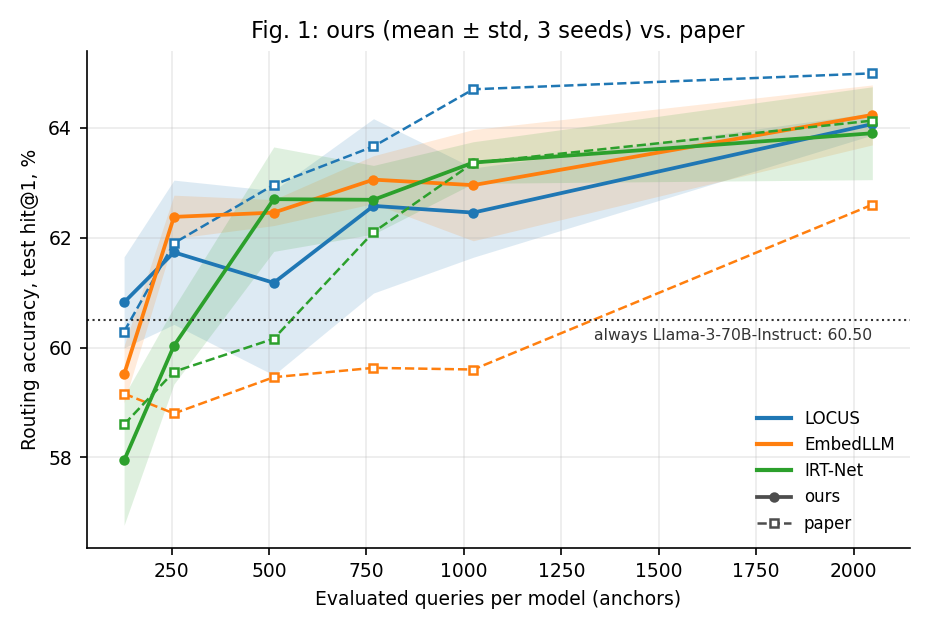

The figure shows the main discrepancy with the paper. Our LOCUS (solid blue) is below the paper's (dashed blue) at ≥ 512 anchors. Our EmbedLLM (solid orange) is 3–3.5 pp above the paper's (dashed orange) and almost everywhere no worse than our LOCUS. The paper's EmbedLLM lies below the trivial router (dotted line). IRT-Net matches the paper.

The paper's original Fig. 1

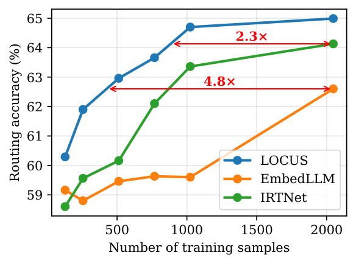

**What matters:**
- **The seed spread is large:** up to 3.2 pp in routing at one budget. The paper apparently reports one run per cell. A 1–2 pp difference between methods or variants at one seed is not significant against this background.
- **The paper's value at 1024 anchors** (64.70) is above the maximum of our three seeds (63.07). Taking the best test value over all epochs instead of the test value at the best-val epoch, our mean at 1024 is 63.44. The gap shrinks but does not close.
- **Checkpoint selection by val hit@1 is noisy.** The last epoch is 1.9–4.2 pp worse than the selected one: the model overfits long before the patience-500 stop.
- **Per-dataset cells (Tables 5–6) cannot be compared one by one.** The test split has only 51 LogiQA and 74 TruthfulQA questions, so one question is 1.4–2 pp. Differences from the paper in these cells reach ±15 pp and mostly reflect noise.

### 2.1 Ablations: sentence encoder and dimension d (R3/R4; Tables 7–10) — numbers reproduced, conclusions not significant

24 new runs: encoders albert / minilm / distilroberta and d ∈ {16, 32, 64, 256, 512} × {256, 512, 1024} anchors, seed 42, everything else default. The mpnet / d = 128 cells are the seed-42 runs of the main grid.

- **Correctness matches the paper almost exactly.** In 23 of 24 new cells the difference is ≤ 0.7 pp; for distilroberta ≤ 0.05 pp. This is strong evidence that our data, anchors and protocol are the authors'.
  - The only exception is albert @ 256: 63.57 vs. 59.42. The paper's value comes from a single cell: correctness on PIQA of 19.50% (ours 63.5%), below the share of "always wrong" answers.
- **Routing is within noise.** In 22 of 24 cells the difference is ≤ 2 pp. The outliers are d = 256 @ 1024 (−2.36) and d = 512 @ 512 (−3.17).
- **One-seed routing conclusions from the ablations are not supported.**
  - The gap between the best and the worst variant at one budget: ours 1.4–3.3 pp, paper 1.2–3.7.
  - The seed spread of the default configuration: 1.5–3.2 pp.
  - Our best variant and the paper's coincide in only 1 of 6 cases (mpnet @ 256).
- **What is stable and matches:**
  - albert is the worst encoder on correctness at every budget. This is expected: it truncates 40% of the queries.
  - distilroberta is no worse than mpnet on correctness (70.33 vs. 69.74 at 1024; paper 70.34 vs. 70.03).
  - The dimension d from 16 to 512 barely affects correctness (spread ≤ 1 pp at one budget). A small d = 16 is enough.

Difference "ours − paper" on every dataset: the overall columns are almost white, especially for correctness. Large differences sit in small datasets (LogiQA 51 questions, TruthQA 74), where one question is 1.4–2 pp.

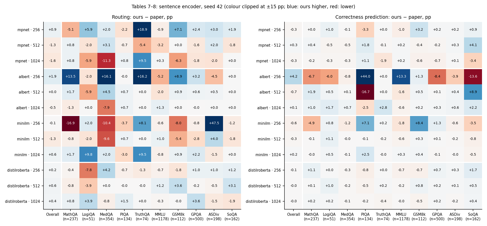

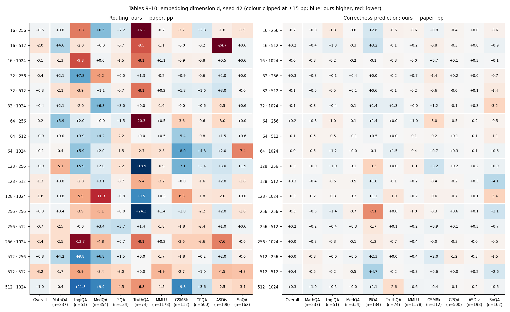

### 2.2 Speed (R13; Fig. 18) — reproduced (scaling)

Reference encoder; inputs already on the GPU; median of 50 runs after 10 warm-ups, fp32. An RTX 3050 Laptop (4 GB) instead of a V100, so we compare the scaling, not the absolute time.

| Models \ queries per model | 256 | 512 | 1024 | 2048 | 4096 |
|---|---|---|---|---|---|
| 1 | 4.4 | 3.6 | 3.6 | 3.6 | 5.1 |
| 16 | 5.1 | 8.0 | 15.3 | 31.5 | 62.0 |
| 64 | 16.0 | 29.8 | 59.4 | 123.3 | 243.9 |
| 112 | 27.5 | 52.7 | 105.1 | 218.9 | 422.7 |

Encoder time, ms.

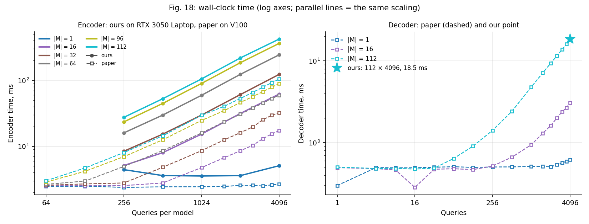

On log axes our lines (solid) and the paper's (dashed) have almost the same slopes: the growth is linear. Ours are shifted up by about 4× — the hardware difference. The paper's lines for different |M| meet at ~2.5 ms for small n, ours at ~4 ms.

The paper's original Fig. 18 (encoder and decoder)

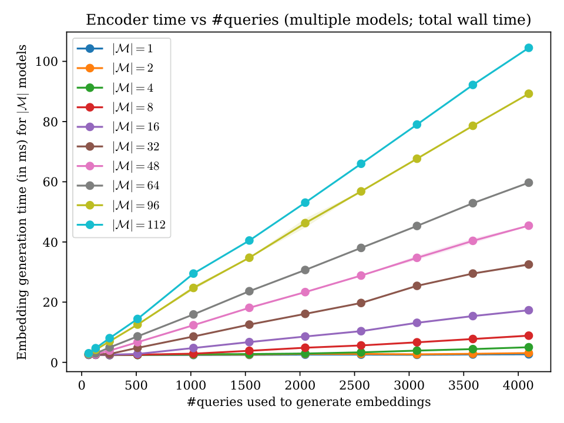

- **The encoder grows linearly** both in queries (×15.4 from 256 to 4096 at 112 models; linear growth would give ×16) and in models. For one model the time is nearly constant (3.6–5.1 ms): the GPU is underused and overhead dominates. This matches the paper.
- **112 models × 4096 queries:** 423 ms vs. ≈104 ms on a V100. A ~4× gap is plausible for a laptop card (the V100 has about 4.7× the memory bandwidth).
- **Decoder, 112 × 4096 pairs:** 18.5 ms on the GPU alone and 21.2 ms through the authors' `score_queries_against_models` with the copy to the CPU. Paper ≈18 ms. The match with the V100 is probably a coincidence: the decoder is small and overhead dominates.

## 3. Baselines (R2; Tables 2, 5, 6, Fig. 1) — not reproduced

All baselines are trained **on the same anchors** as the corresponding LOCUS run. Hyperparameters are chosen by val hit@1 (IRT-Net: its official ones, no tuning); metrics are computed with the authors' function.

### 3.1 Summary (routing, mean over 3 seeds) — the LOCUS advantage does not reproduce

| Anchors | LOCUS | EmbedLLM | EmbedLLM+ | IRT-Net | K-Means | kNN | Paper: LOCUS / EmbedLLM / IRT-Net / K-Means / kNN |
|---|---|---|---|---|---|---|---|
| 128 | 60.82 | 59.51 | 59.84 | 57.94 | 61.24 | 60.07 | 60.29 / 59.16 / 58.60 / — / — |
| 256 | 61.73 | 62.38 | 61.21 | 60.03 | 62.33 | 61.17 | 61.90 / 58.80 / 59.57 / 61.33 / 60.50 |
| 512 | 61.18 | 62.46 | 62.18 | 62.70 | 61.72 | 61.00 | 62.97 / 59.47 / 60.17 / 64.47 / 61.37 |
| 768 | 62.58 | 63.06 | 62.46 | 62.69 | 63.56 | 61.22 | 63.66 / 59.63 / 62.10 / — / — |
| 1024 | 62.46 | 62.96 | 63.26 | 63.37 | 63.04 | 62.20 | 64.70 / 59.60 / 63.37 / 66.20 / 62.90 |
| 2048 | 64.07 | 64.23 | 65.24 | 63.90 | 64.38 | 63.66 | 64.99 / 62.60 / 64.13 / — / — |

Paper values at 128, 768 and 2048 are from Fig. 1. The trivial router "always Llama-3-70B-Instruct" (the best model by train accuracy) scores **60.50**.

**Paired by seed** (same anchor set; LOCUS minus baseline, 18 pairs):

| Against | Routing: LOCUS wins / mean difference | Correctness: LOCUS wins / mean difference |
|---|---|---|
| EmbedLLM | 5 / −0.29 | 16 / +0.53 |
| EmbedLLM+ | 7 / −0.23 | 17 / +0.86 |
| IRT-Net | 10 / +0.37 | **2** / −0.42 |
| K-Means | 5 / −0.57 | 14 / +2.10 |
| kNN | 13 / +0.59 | 17 / +2.19 |

**Tables 5–6 in full: difference "ours − paper" on every dataset.** The full tables with numbers are in Appendix A.

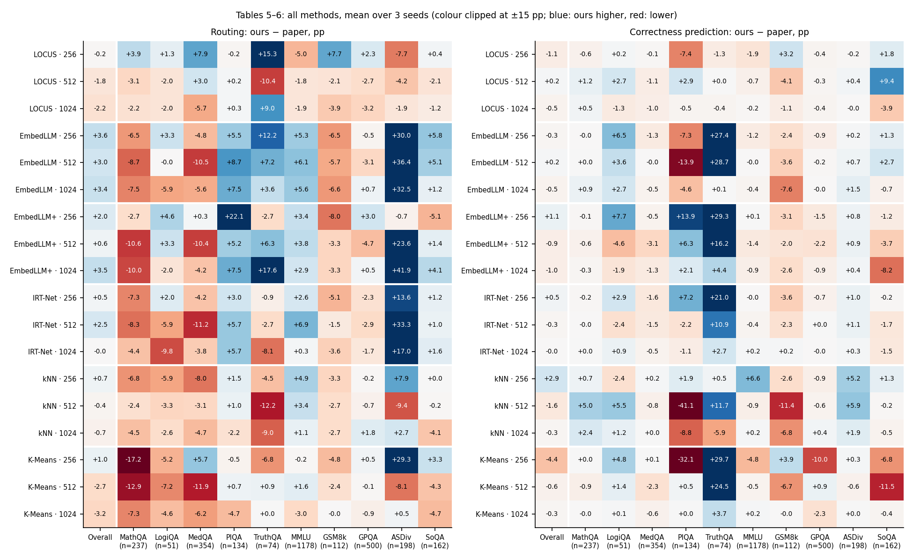

What stands out:
- **The ASDiv column of EmbedLLM, EmbedLLM+ and IRT-Net is dark blue** (+13…+42 pp). This is the trace of the paper's degenerate routers: Llama-3-70B-Instruct almost always fails on ASDiv (10%), and a router that never leaves it fails with it (§3.2).
- **The LOCUS rows are almost white overall** but mottled per dataset. On small datasets (LogiQA 51 questions, TruthQA 74) differences of ±10–15 pp are single-run noise.
- **Correctness** is white almost everywhere. Large differences appear for kNN and K-Means at 256–512 on PIQA and TruthQA (down to −41 pp); the paper probably used other k and K.

### 3.2 EmbedLLM — the paper's numbers do not reproduce (ours is 3–3.5 pp stronger)

- **Implementation.** Follows the official TextMF (`algorithm/mf.py`, commit `9b27630`): dimension 232, noise 0.05, CE loss, batch 2048, weight decay 1e-5, the same mpnet query embeddings. lr chosen from {1e-4, 1e-3}, the epoch by val hit@1, as for LOCUS. EmbedLLM+ has 1 or 2 hidden layers: the paper does not give the number, we chose by val.
- **Our EmbedLLM is 3–3.5 pp stronger than the paper's** at 256–1024 anchors.
- **The official protocol does not explain the gap.** We checked it separately: 50 epochs, lr 1e-4, last epoch.
  - At small budgets it undertrains the model: 55.5 at 128 anchors.
  - But at 1024 it gives **62.77**, versus the paper's 59.60.
  - Shuffling the data changes nothing.
- **The paper's EmbedLLM behaves like a router that always picks the single strongest model.** This is visible per dataset:

  | Router | Overall | MathQA | LogiQA | MedQA | PIQA | TruthQA | MMLU | GSM8k | GPQA | ASDiv | SoQA |
  |---|---|---|---|---|---|---|---|---|---|---|---|
  | Always Llama-3-70B-Instruct | 60.50 | 59.9 | 47.1 | 75.4 | 85.1 | 41.9 | 78.3 | 89.3 | 29.0 | **10.1** | 30.9 |
  | Paper's EmbedLLM, 256 | 58.80 | 58.2 | 41.2 | 72.0 | 79.9 | 35.1 | 75.6 | 88.4 | 28.2 | **19.2** | 30.3 |
  | Paper's EmbedLLM, 512 | 59.47 | 59.5 | 45.1 | 74.3 | 77.6 | 43.2 | 76.8 | 89.3 | 28.8 | **12.1** | 29.6 |
  | Paper's EmbedLLM, 1024 | 59.60 | 58.7 | 51.0 | 72.9 | 79.1 | 47.3 | 76.8 | 89.3 | 23.8 | **25.3** | 30.9 |
  | Our EmbedLLM, 1024 | 62.96 | 51.2 | 45.1 | 67.3 | 86.6 | 50.9 | 82.4 | 82.7 | 24.5 | **57.7** | 32.1 |

  - The mean difference between the paper and "always 70B" over the 10 datasets: 3.7 / 1.7 / 4.1 pp at 256 / 512 / 1024. For our EmbedLLM it is 8.0–9.3 pp: it really picks different models for different queries.
  - The paper's GSM8K is 89.29 at 512 and 1024 — exactly the "always 70B" value. The paper's ASDiv is 12–25% versus 49–58% for ours: Llama-3-70B-Instruct almost always fails on ASDiv (10%), and a router that never leaves it fails as well.
  - **The router "always the best model on this run's anchors"** (no training at all) scores 59.62 / 58.77 / 59.62 at 256 / 512 / 1024, averaged over our three seeds. The paper's EmbedLLM: 58.80 / 59.47 / 59.60.
- **A plausible explanation.** An undertrained matrix factorisation learns mostly main effects — "strong model" and "hard query". For correctness that is almost enough, which is why the paper's EmbedLLM correctness looks normal. Routing needs the argmax over models, and the model main effect makes it the same for every query. This agrees with our run of the official protocol: at 128 anchors it undertrains and gives 55.5, below the trivial router, but not at 1024. The hypothesis cannot be checked directly: we do not have the paper's EmbedLLM predictions.
- **IRT-Net from the same paper reproduces to 0.01 pp** (§3.4), so the data, metrics and environment match. The discrepancy is specific to EmbedLLM.
- **What it means for the conclusions.** As a comparison method, the paper's EmbedLLM appears to be poorly trained: its result is indistinguishable from a training-free router. With a properly trained EmbedLLM the LOCUS advantage in routing disappears, and the one in correctness stays small (+0.5…+0.9 pp).
- **Fig. 1, "4.8×".** Our EmbedLLM@2048 = 64.23. LOCUS does not reach this value at any budget ≤ 2048; only the reference encoder at 4096 anchors gives 66.23. With the paper's own numbers the same comparison gives 512 anchors.

### 3.3 kNN and K-Means — kNN reproduced, K-Means 2.7–3.2 pp below the paper

- **Settings.** The paper gives neither k nor K.
  - kNN: cosine on mpnet, k ∈ {1, …, 500}; the selected k are 50–200, so the grid had to extend beyond 100.
  - K-Means: n_init = 10, K ∈ {2, …, 64}.
- **kNN** reproduces: within ~0.7 pp of the paper.
- **The paper's kNN at 256 anchors is the router "always Llama-3-70B-Instruct".** Its Table 5 row equals our trivial router **in all 11 values** to 0.01 pp (overall 60.50, ASDiv 10.10, GSM8K 89.29, …). So their kNN always picked one model at this budget — probably because of a very large k. Our kNN at 256 scores 61.17 and picks different models. This is another degenerate baseline in the paper's table, like EmbedLLM (§3.2).
- **K-Means** is 2.7–3.2 pp below the paper at 512 and 1024. This is the same gap as for LOCUS, so the LOCUS / K-Means relation matches the paper: K-Means is no worse than LOCUS at routing.

### 3.4 IRT-Net — reproduced; the 2.3× claim does not reproduce

- **Implementation.** Architecture and hyperparameters follow the official repository ([JianhaoChen-nju/IrtNet](https://github.com/JianhaoChen-nju/IrtNet), commit `6cf5eec`, `pipeline.sh`).
  - A dense mixture of 39 experts plus a shared expert; a(x) of dimension 232 and b(x); θ_m.
  - BCE, lr 1e-4, weight decay 1e-4, dropout 0.5, up to 30 epochs, early stopping and checkpoint selection by val accuracy (as in the official code, not by val hit@1). No hyperparameter tuning.
- **No code was copied:** the repository has no licence, so the architecture was re-implemented.
- **IRT-Net reproduces almost exactly:**

| Anchors | Routing (mean ± std) | Paper | Correctness | Paper |
|---|---|---|---|---|
| 256 | 60.03 ± 0.70 | 59.57 | 67.87 | 67.38 |
| 512 | 62.70 ± 0.95 | 60.17 | 68.78 | 69.07 |
| 1024 | 63.37 ± 0.38 | 63.37 | 70.10 | 70.12 |
| 2048 | 63.90 ± 0.85 | 64.13 (Fig. 1) | 70.66 | — |

  - Only routing at 512 deviates (+2.5 pp).
- **Against LOCUS:**
  - routing is a tie: LOCUS wins 10 of 18 pairs, mean difference +0.37;
  - **correctness: IRT-Net is better**: LOCUS wins only 2 of 18 pairs, on average −0.42 pp. The paper's own Table 6 shows the same: at 512 and 1024 IRT-Net is above LOCUS (69.07 vs. 68.33; 70.12 vs. 70.03).
- **Fig. 1, "2.3×".** Our IRT-Net@2048 = 63.90; LOCUS reaches it only at 2048 anchors (64.07), so there is no efficiency gain. With the paper's numbers LOCUS reaches 64.13 between 768 and 1024 — hence 2.3×.
- **Why this matters for §3.2.** The paper's second baseline, on the same data and with its official protocol, matches the paper to 0.01 pp, while EmbedLLM does not, even with its official protocol. So the EmbedLLM discrepancy is not explained by differences in data, metrics or environment.

## 4. Embedding experiments — mostly reproduced

The experiments use the reference encoder (4096 anchors, seed 42). Its embedding bank reproduces the training metrics to 0.01 pp.

### 4.1 Robustness (R6; Fig. 4, 5, 13, 14) — reproduced

| Number of queries (out of the 4096 reference ones) | 8 | 128 | 384 | 1024 |
|---|---|---|---|---|
| Routing, ours / paper | 0.487 / 0.468 | 0.608 / 0.626 | 0.644 / 0.644 | 0.657 / 0.649 |
| Correctness, ours / paper | 0.676 / 0.670 | 0.702 / 0.705 | 0.705 / 0.710 | 0.707 / 0.711 |

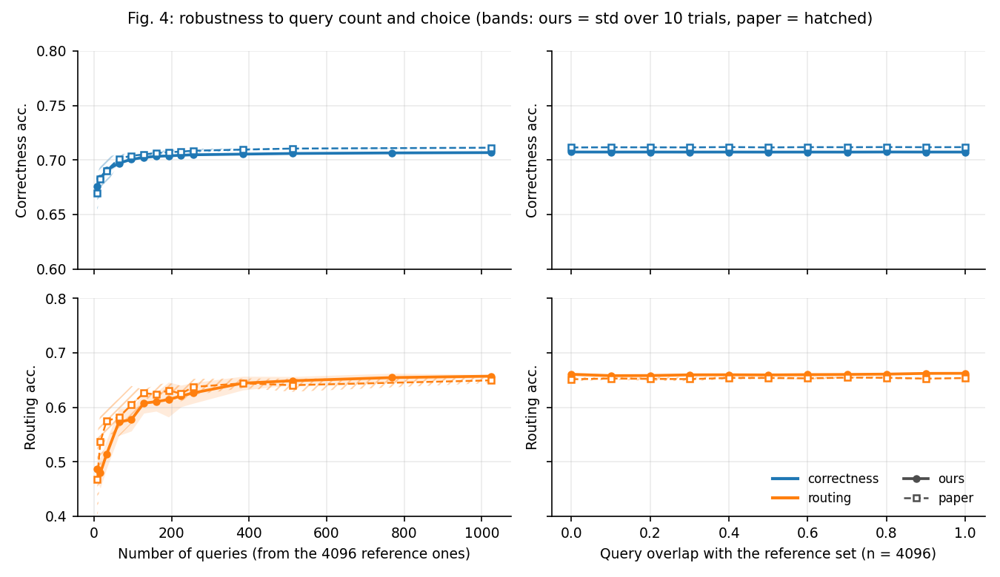

The curves almost coincide. Our correctness is ~0.004 below the paper along the whole curve — the difference between the reference encoders (ours 0.7073 vs. 0.711).

The paper's original Fig. 4

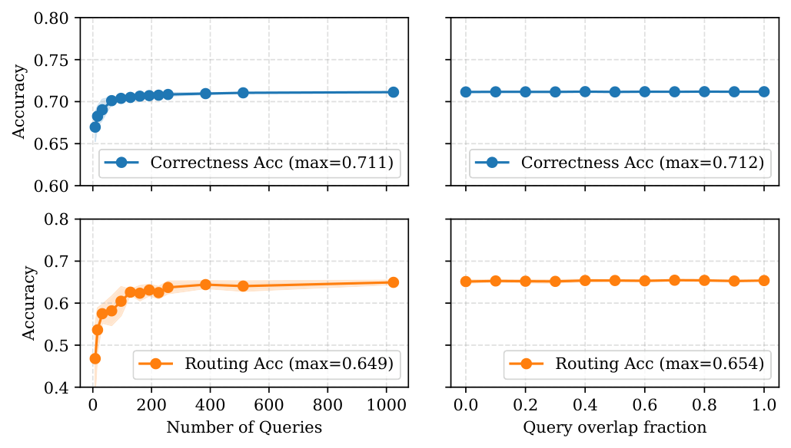

- **Overlap with the reference set** (n = 4096, as in the paper): the curves are flat.
  - Routing 0.658–0.662, correctness 0.7073 ± 0.0002.
  - Even 4096 completely different queries change almost nothing.
- **Fig. 13–14** use CodeLlama-13b-**Instruct**-hf: the paper's CodeLlama-13b-hf is not among the 112 models.
  - Absolute distances are not comparable with the paper: our embeddings are larger, the maximum pairwise distance is 35.5 vs. ~22.
  - In units of the nearest-neighbour distance, the dependence on the number of queries (Fig. 14) matches well: at n = 256 the shift is ×6.7 for both us and the paper; at n = 1024 it is ×2.3 vs. ×2.8.
  - With overlap (Fig. 13) our embedding moves **less** than the paper's: at overlap 0, ~3 nearest-neighbour distances vs. ~12 for cosine, and 1.5 vs. 3.3 for Euclidean. The shape of the curves is the same.

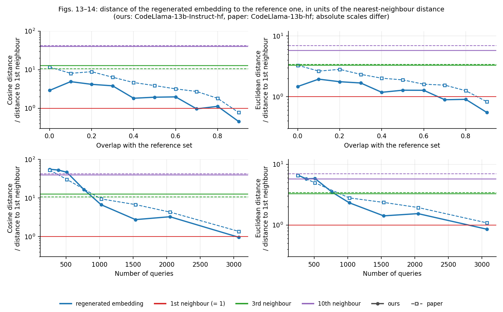

The paper's original Figs. 13 and 14

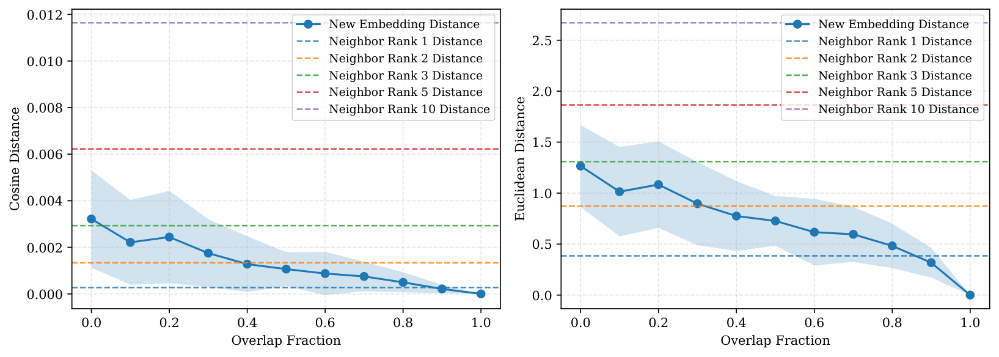
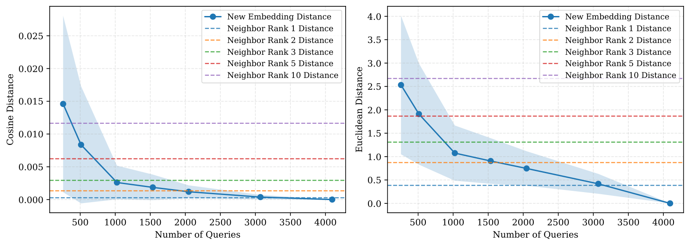

- **Fig. 5 (t-SNE)** can only be compared qualitatively: regenerated embeddings land next to the reference ones, as in the paper.

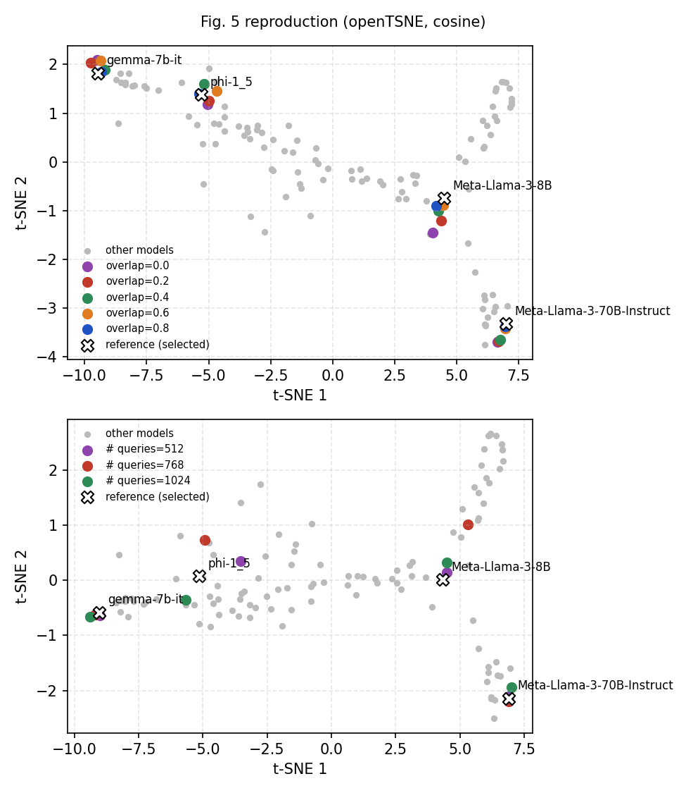

The paper's original Fig. 5

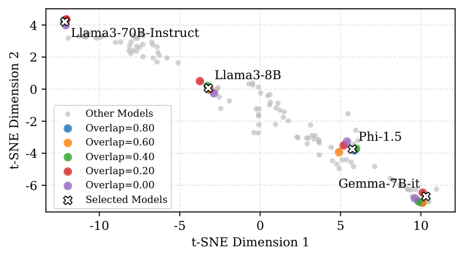
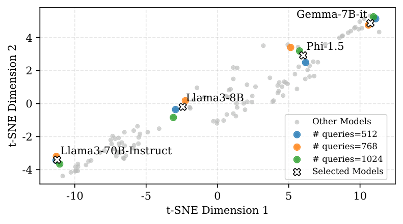

- **Is the model recognised? (not in the paper).** We counted the share of models whose own reference embedding is the nearest one to the regenerated embedding: 34% with completely different 4096 queries, 13% with 256 of the reference queries, 76% with 3072.
  - The embedding points to the right neighbourhood, so the metrics do not suffer, but not to the specific model.
  - The pool contains many near-duplicates (Luminex v0.1/v0.2, BioMistral and BioMistral-DARE, vicuna fine-tunes). So the paper's fingerprinting claim should be read as "the same family or a similar profile", not "the same model".

### 4.2 Geometry (R7, R8, R9a; Table 3, Fig. 6–8) — reproduced (R7: mostly)

| Correlation with test disagreement (6216 pairs) | Cosine, ours | Paper | Euclidean, ours | Paper |
|---|---|---|---|---|
| Pearson | 0.838 | 0.845 | 0.792 | 0.887 |
| Spearman | 0.845 | 0.886 | 0.794 | 0.876 |
| Kendall | 0.654 | 0.714 | 0.593 | 0.702 |

- **Dependence on the encoder.** For encoders trained on 1024 and 2048 anchors (6 runs), Pearson is 0.82–0.87 for cosine and 0.81–0.85 for Euclidean. The reference encoder is the weakest in Euclidean terms.
- **A control not in the paper: raw labels.** The Hamming distance computed directly on the answers to the same 4096 anchors correlates **0.99** with test disagreement. The embedding geometry is inherited from the labels and loses a little; the value of the embedding is the compression to 128 numbers and the ability to build it from any set of queries.
- **Fig. 6.** The "distance vs. disagreement" scatter plots look alike; the numbers are compared in the table above.

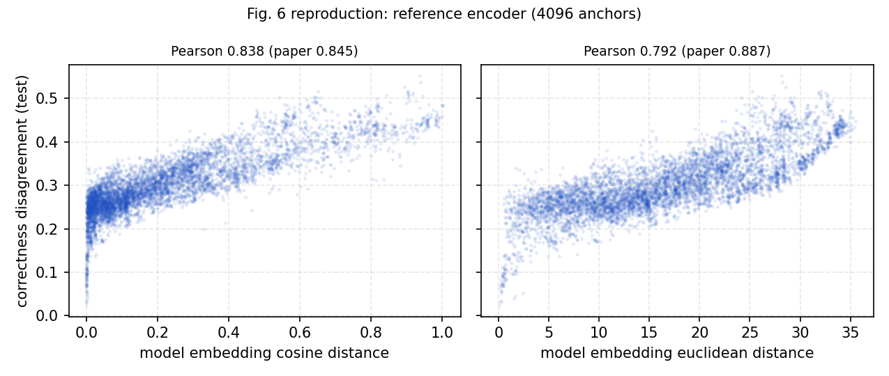

The paper's original Fig. 6

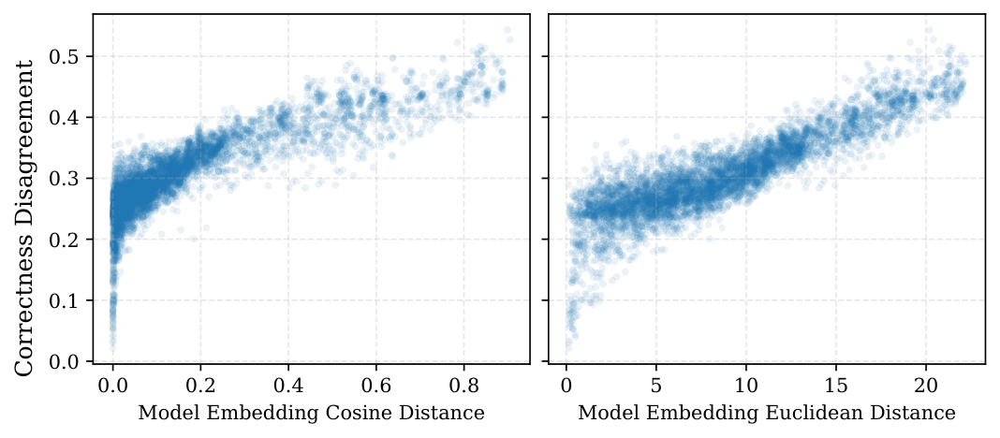

- **Fig. 7.** The families separate with complete, average and ward linkage. The tree topology and the order of pair merges match the paper.
  - That the authors used complete linkage we inferred from their figure: the merge heights equal the maximum pairwise distances. The paper's text does not say so.
  - **All 21 pairwise distances** in the paper's heatmap correlate with ours with Pearson **0.976**. Ours are ~1.4× larger — a difference of scale.

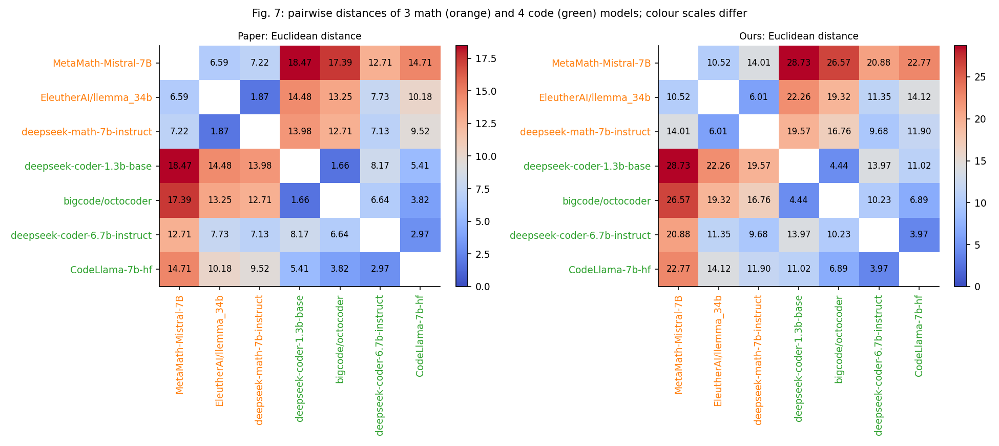

<table class="pair"><tr><td>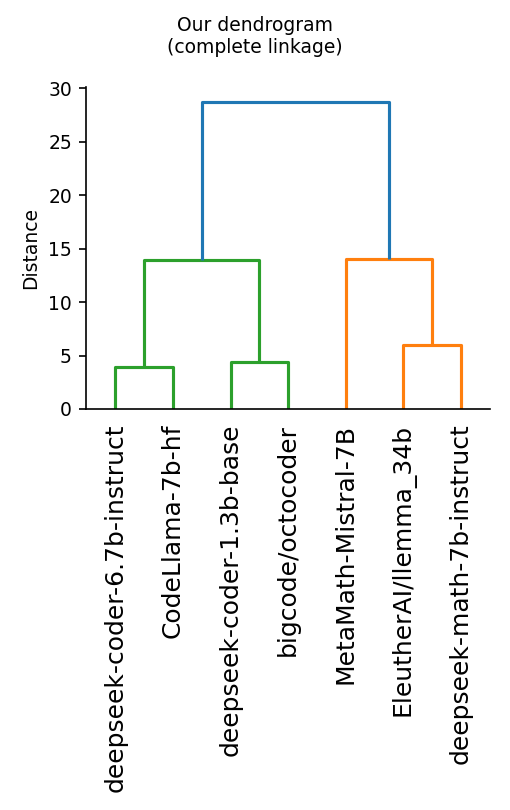</td>
<td><b>The paper's dendrogram</b> 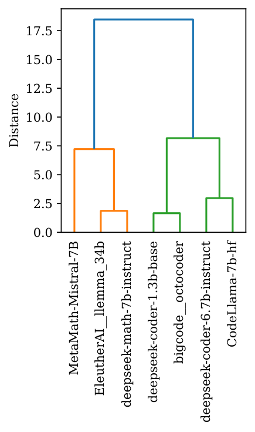</td>
<td>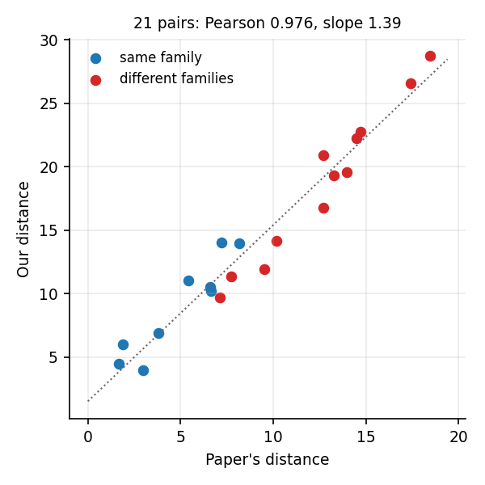</td></tr></table>

- **Fig. 8.** Agreement with the k-th neighbour: 0.802 / 0.741 / 0.714 / 0.636 at k = 1 / 20 / 50 / 99; paper 0.789 / 0.740 / 0.709 / 0.624. The curves coincide almost everywhere. Raw labels give 0.834 at k = 1, then the curves coincide.

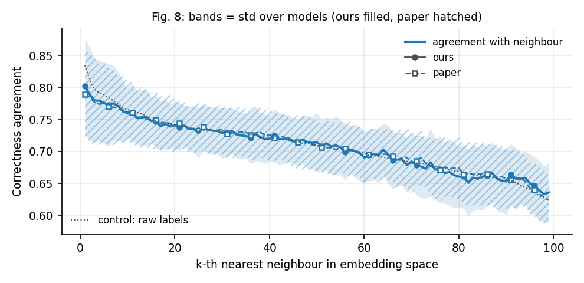

The paper's original Fig. 8

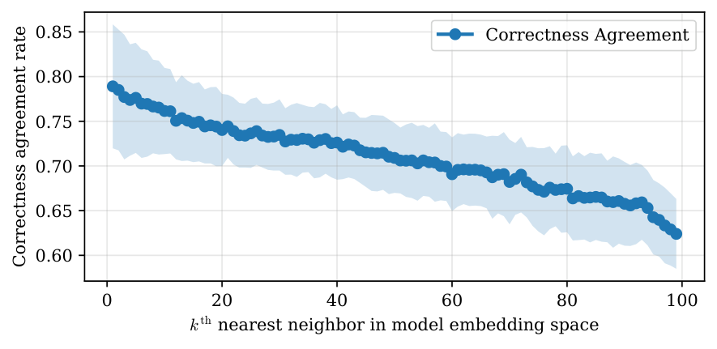

### 4.3 Applications (R9b, R10, R11; Fig. 9, 11, 12) — R9b reproduced, R10 partially, R11 not reproduced

- **Fig. 12: replacing an unavailable model by its k-th neighbour (R9b, reproduced).**
  - k = 1: 0.561 (84.8% of 0.662); k = 15: 0.495; k = 49: 0.441. Paper 0.557 / 0.463 / 0.417 (84.7% of 0.657), and the same curve shape, including the step near k ≈ 15.
  - For comparison: the router's own second choice gives 0.592, a random model 0.40.

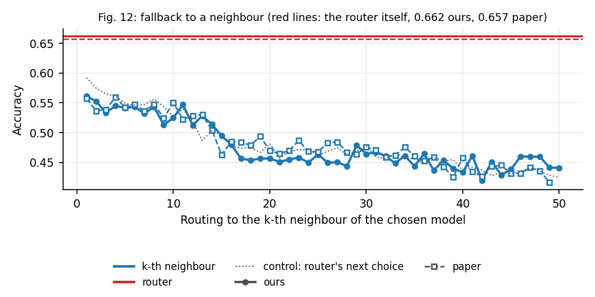

The paper's original Fig. 12

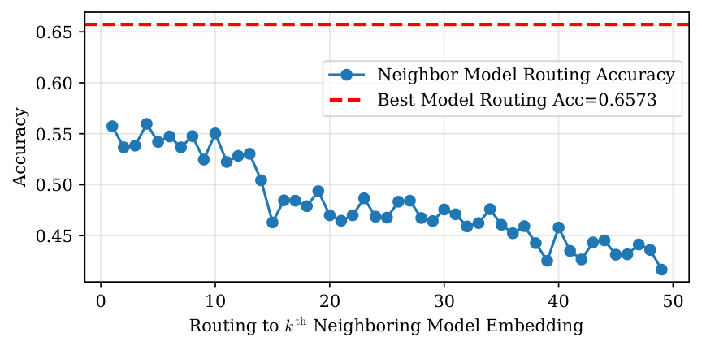

- **Fig. 9 by number of models (R10, partially).** k-center: 0.635 at k = 7 and 0.659 at k = 20 (full pool 0.662). Paper 0.635 at k = 5 and 0.659 at 15–25.
  - The jump happens when Llama-3-70B-Instruct enters the set. k-center first collects "outliers" (shisa, Qwen-0.5B, phi-1.5), so the moment of the jump is largely chance.
  - k-medoids: 0.574 at k = 15 (paper 0.637).
  - **A control not in the paper:** "take the k most accurate models by train accuracy" gives **0.639 already at k = 3**, better than both methods for k < 7. Covering the embedding space wins only at k ≥ 20 (0.659 vs. 0.640).
- **Fig. 9 by parameter budget.** Coverage-greedy stays at ~0.57 from 50 to 300B and jumps to 0.637 only at 400B. The paper reaches 0.625 already at 140B.
  - Reason: the gain is divided by the parameter count, so large strong models are postponed.
  - Simply taking "the most accurate models that fit the budget" is better almost everywhere: 0.631 at 110B.
  - Model sizes are nominal, from the model names. Total 1947.5B vs. 1930B in the paper; MoE models counted with all experts.

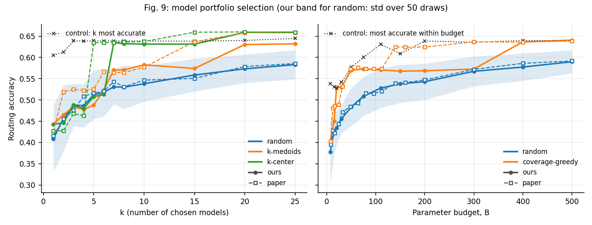

Random selection (blue) matches the paper almost point for point. The embedding-based methods match in shape, but the jumps happen at other k and budgets. The black dotted line is our "most accurate models" control: it is the best for small k.

The paper's original Fig. 9

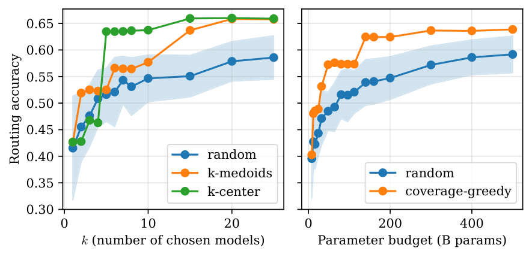

- **Fig. 11: hypothetical embeddings (R11, not reproduced at large n),** recall@10.

  | n | 10-dataset profile | 80-task profile | Real labels | Paper |
  |---|---|---|---|---|
  | 256 | 0.45 | 0.54 | 0.45 | 0.529 |
  | 1024 | 0.61 | 0.73 | 0.78 | 0.715 |
  | 4096 | 0.60 | 0.83 | 0.93 | 0.939 |
  | 8192 | 0.58 | 0.83 | 0.96 | 0.968 |

  - The paper's caption says "dataset-wise", the text "task-wise". We computed both.
  - At large n the paper's synthetic labels score as high as our real labels. So the authors' protocol differs in something that cannot be recovered from the text.

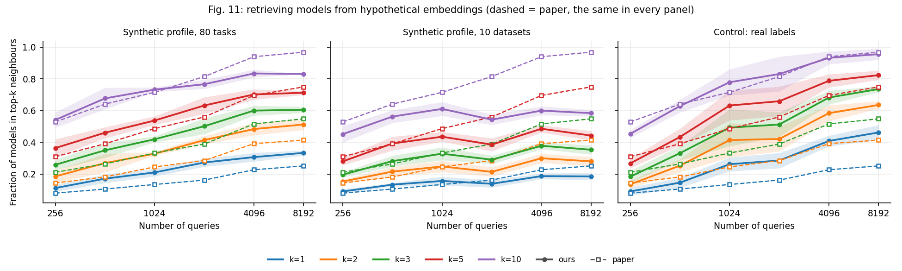

The paper's dashed lines are the same in all three panels. They are closest to our right panel, with real labels. Our 80-task profile matches the paper up to n ≈ 1024 and then plateaus.

The paper's original Fig. 11

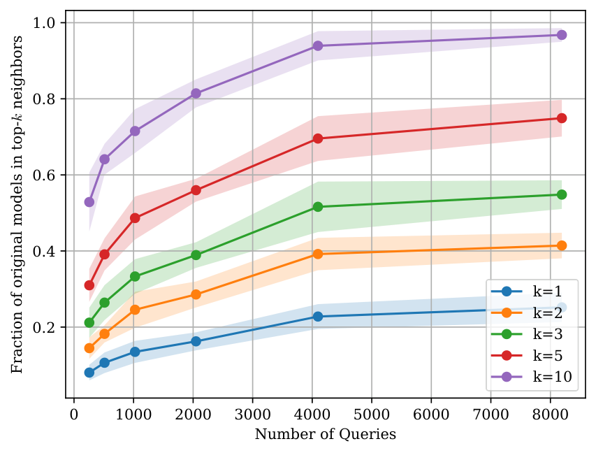

### 4.4 Onboarding new models (R5; Fig. 3) — partially reproduced

Encoders are trained on nested pools of 8, 16, 32, 64 and 96 models from models 0–95 (1024 anchors, seed 42). They embed the 16 held-out models (96–111) from n random queries; 5 draws.

| Encoder trained on | n = 16: ours / paper | 128 | 1024 | Difference from the full pool at 1024: ours / paper |
|---|---|---|---|---|
| 112 models (full pool; ours 3 seeds) | 0.684 / 0.682 | 0.703 / 0.703 | 0.708 / 0.709 | — |
| 96 models | 0.683 / 0.690 | 0.701 / 0.705 | 0.704 / 0.711 | −0.4 / +0.2 pp |
| 64 models | 0.664 / 0.683 | 0.673 / 0.708 | 0.672 / 0.712 | −3.6 / +0.3 pp |
| 32 models | 0.671 / 0.692 | 0.685 / 0.706 | 0.686 / 0.712 | −2.2 / +0.3 pp |
| 16 models | 0.672 / 0.686 | 0.685 / 0.703 | 0.687 / 0.706 | −2.1 / −0.3 pp |
| 8 models | 0.672 / 0.678 | 0.685 / 0.701 | 0.687 / 0.703 | −2.1 / −0.6 pp |
| No network: per-dataset model accuracy from the same n answers | 0.620 / — | 0.685 / — | 0.707 / — | — |

The paper's values are recovered from the cell colours of its figure.

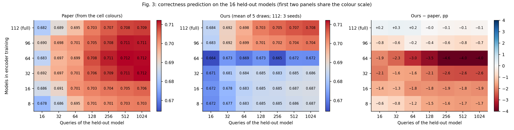

The paper's original Fig. 3

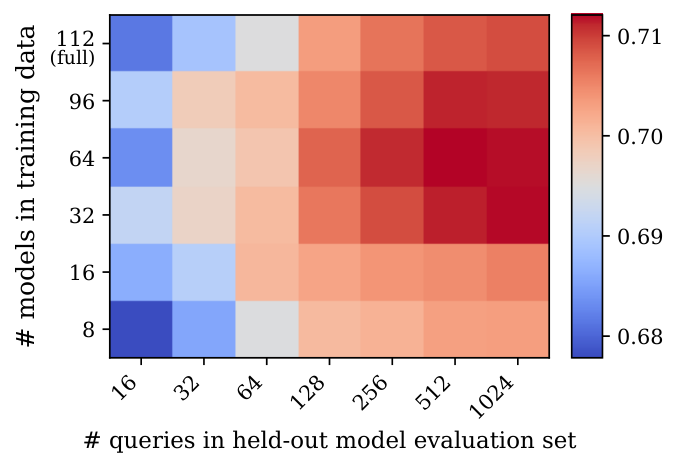

- **The full pool matches the paper almost to the third decimal** (0.684 / 0.703 / 0.708 vs. 0.682 / 0.703 / 0.709), and "~128 queries are enough" is confirmed.
- **In the paper, pools of 32–96 are even slightly better than the full pool** (up to +0.3 pp); ours are 0.4–3.6 pp worse. In the right panel this is the red band in every row except the full pool.
- **Pools of 8–64 are worse than the paper because of the checkpoint rule.** The authors' script keeps the epoch with the best val hit@1.
  - In pools containing Llama-3-70B-Instruct, "always pick it" already gives val hit@1 ≈ 0.599 at epoch 0, and training barely exceeds it. So an early, undertrained epoch is kept.
  - Pool 64: epoch 18, val acc 0.641, although it reached 0.688 by epoch 118. Pool 32: epoch 24.
  - **We kept the authors' code and did not retrain with another rule.** The result is reported as is.
- **The no-network reference** catches up with LOCUS at n = 1024 (0.707). LOCUS has a clear advantage only at small n: +6.4 pp at n = 16 and +1.9 at n = 128. That is exactly the value of the encoder: it fills in missing answers with knowledge about other models.
- The paper's text gives the pool sizes as {8, 16, …, 92}, the figure 96. We used 96.

### 4.5 Instability of EmbedLLM embeddings (R12; Fig. 15–17) — partially reproduced

EmbedLLM is trained on the same 4096 reference anchors. Then the predictor G is frozen and the model embeddings are retrained. Early stopping on val CE (patience 5), lr 1e-3, one seed.

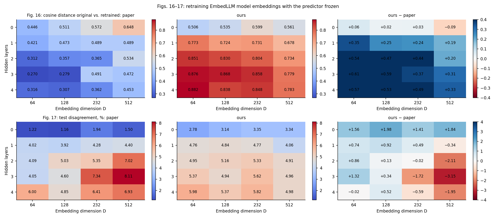

The paper's original Figs. 16 and 17

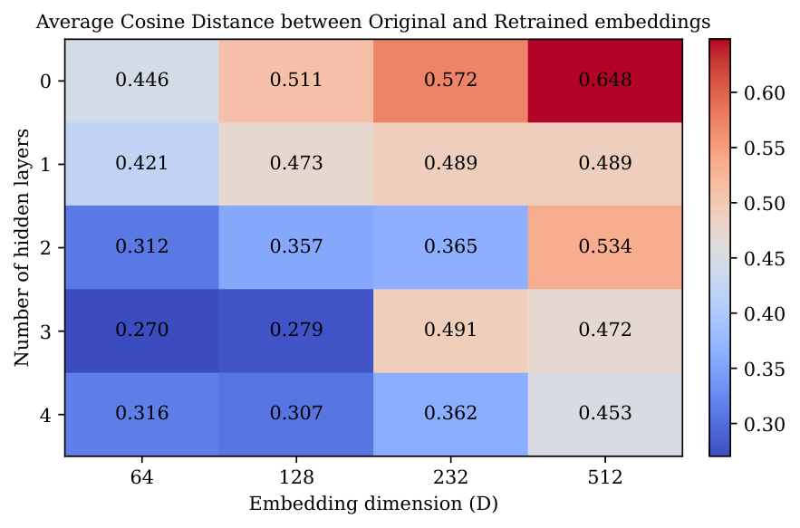
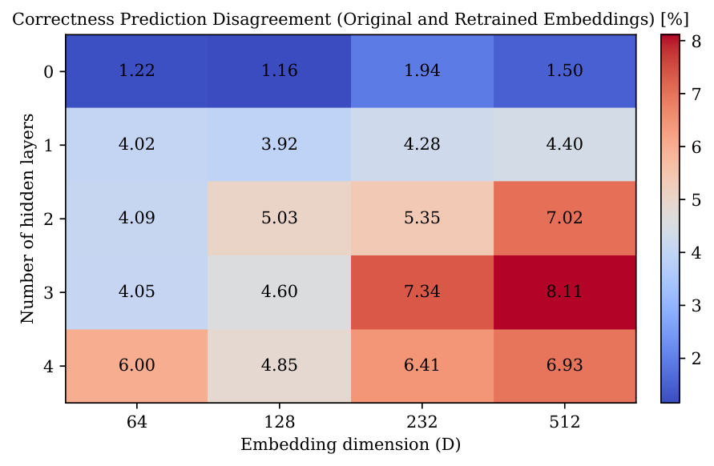

- **Fig. 17, share of changed test predictions:** 2.8–6.0% for 0–4 hidden layers and D ∈ {64, 128, 232, 512}. Paper 1.2–8.1%. The range reproduces, but cells differ: without hidden layers ours is higher (2.8–3.4% vs. 1.2–1.9%), with 3 layers and D = 512 lower (5.0% vs. 8.1%).
- **Fig. 16, cosine distance before / after:**
  - without hidden layers 0.51–0.60, paper 0.45–0.65 — a match;
  - with hidden layers ours is 0.68–0.88, while the paper's distance is, on the contrary, smaller (e.g. 0.27 with 3 layers and D = 64). The trend is reversed. A possible reason: our deeper variants early-stop on val CE already at epochs 1–9.
- **Comparison with LOCUS by scale-free quantities** (both methods get new queries):

  | Query set | Changed predictions: LOCUS / EmbedLLM | Model recognised: LOCUS / EmbedLLM |
  |---|---|---|
  | 4096 completely different queries | **1.7% / 4.6%** | **30% / 13%** |
  | 1024 of the original ones | 1.9% / 4.4% | 40% / 33% |

  "Model recognised" means the original embedding nearest to the regenerated one is the model's own.
- **Conclusion:** LOCUS is indeed more stable, by about 2.5× in the share of changed predictions. But the paper's cross-method cosine comparison ("LOCUS 0.005 vs. EmbedLLM 0.8") is not meaningful: in the LOCUS space even different models are at cosine 0.0002–0.009 from each other. And "distance 0 for LOCUS on the same data" holds by construction: the forward pass is deterministic.
- **The official EmbedLLM is recognised quite well:** without hidden layers and with D = 232, after retraining on the same data it finds its own model in 82% of cases, at D = 512 in 90%.
- **Fig. 15 (t-SNE),** qualitatively only: retrained EmbedLLM embeddings scatter away from the original ones, as in the paper.

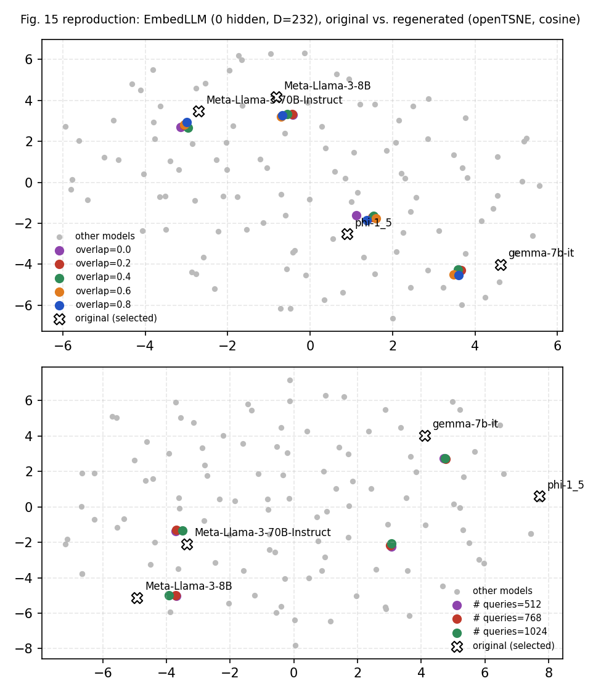

The paper's original Fig. 15

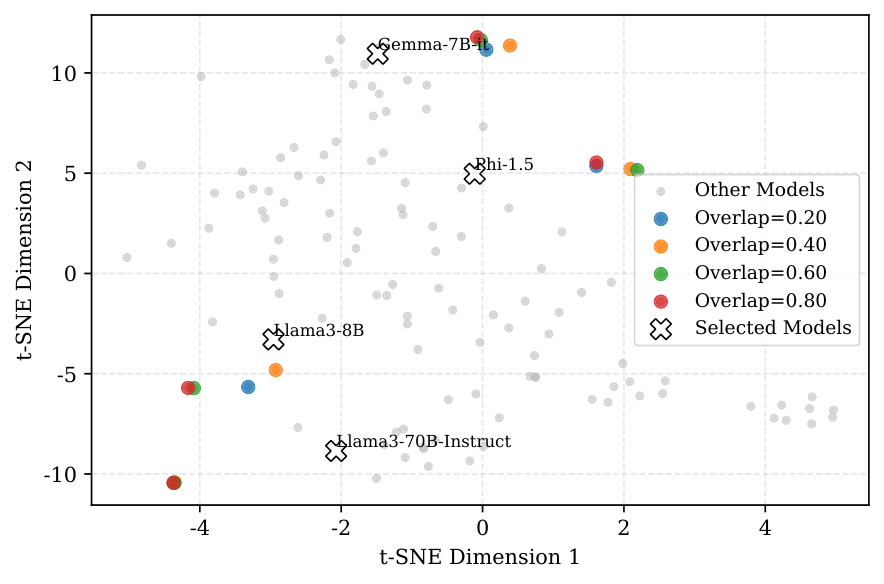
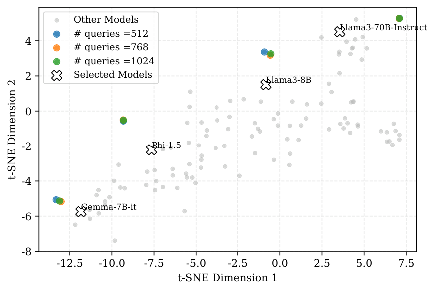

## 5. Limitations

- **One seed** in the ablations (§2.1), for the reference encoder, in Fig. 3 and in the EmbedLLM-instability experiment. The main grid and the baselines use 3 seeds. The seed spread (up to 3.2 pp) is comparable to most of the differences being compared.
- **Different hardware.** An RTX 3050 with 4 GB instead of a V100: absolute times (§2.2) are not comparable, and training with > 1024 anchors uses gradient accumulation over model micro-batches, which is equivalent to the authors' setup only in expectation.
- **No original predictions or checkpoints from the authors.** The comparison relies on the published numbers: the LaTeX tables and the values extracted from the paper's vector figures.
- **Checkpoint selection by val hit@1** is kept as in the authors' code, although it yields undertrained encoders in Fig. 3 (§4.4).
- **Several parameters are not specified in the paper** and were chosen by us (k and K for kNN / K-Means, lr and depth for EmbedLLM, the linkage for Fig. 7, the number of repetitions). Where the choice could affect a conclusion (the EmbedLLM protocol, the profile in Fig. 11), we checked several options.

## Appendix A. The paper's tables with our values

Paper values are taken from the LaTeX source of the paper.

Cell: our value (ours − paper), percentage points. Bold: difference ≥ 5 pp. Our LOCUS and baselines: mean over seeds 42–44; ablations: seed 42. Test questions per dataset: MathQA 237, LogiQA 51, MedQA 354, PIQA 134, TruthQA 74, MMLU 1178, GSM8k 112, GPQA 500, ASDiv 198, SoQA 162.

### Table 2 (overall): ours / paper

| Method | Routing 256 | 512 | 1024 | Correctness 256 | 512 | 1024 |
|---|---|---|---|---|---|---|
| LOCUS | 61.73 / 61.90 | 61.18 / 62.97 | 62.46 / 64.70 | 67.25 / 68.31 | 68.50 / 68.33 | 69.49 / 70.03 |
| EmbedLLM | 62.38 / 58.80 | 62.46 / 59.47 | 62.96 / 59.60 | 66.98 / 67.33 | 68.29 / 68.12 | 68.94 / 69.47 |
| EmbedLLM+ | 61.21 / 59.17 | 62.18 / 61.57 | 63.26 / 59.73 | 67.19 / 66.14 | 67.14 / 68.09 | 68.31 / 69.33 |
| IRT-Net | 60.03 / 59.57 | 62.70 / 60.17 | 63.37 / 63.37 | 67.87 / 67.38 | 68.78 / 69.07 | 70.10 / 70.12 |
| kNN | 61.17 / 60.50 | 61.00 / 61.37 | 62.20 / 62.90 | 63.50 / 60.60 | 66.28 / 67.90 | 68.93 / 69.27 |
| K-Means | 62.33 / 61.33 | 61.72 / 64.47 | 63.04 / 66.20 | 61.96 / 66.34 | 67.67 / 68.32 | 69.28 / 69.57 |

### Table 5: routing accuracy by dataset

| | Anchors | Overall | MathQA | LogiQA | MedQA | PIQA | TruthQA | MMLU | GSM8k | GPQA | ASDiv | SoQA |
|---|---|---|---|---|---|---|---|---|---|---|---|---|
| LOCUS | 256 | 61.7 (−0.2) | 43.6 (+3.9) | 42.5 (+1.3) | **63.6 (+7.9)** | 85.6 (−0.2) | **49.1 (+15.3)** | **81.2 (−5.0)** | **83.6 (+7.7)** | 27.5 (+2.3) | **57.9 (−7.7)** | 30.0 (+0.4) |
| LOCUS | 512 | 61.2 (−1.8) | 46.7 (−3.1) | 41.2 (−2.0) | 60.9 (+3.0) | 86.8 (+0.2) | **42.3 (−10.4)** | 81.9 (−1.8) | 83.6 (−2.1) | 24.7 (−2.7) | 56.4 (−4.2) | 28.8 (−2.1) |
| LOCUS | 1024 | 62.5 (−2.2) | 50.5 (−2.2) | 47.1 (−2.0) | **66.9 (−5.7)** | 85.3 (+0.3) | **50.9 (+9.0)** | 80.0 (−1.9) | 85.4 (−3.9) | 26.0 (−3.2) | 62.8 (−1.9) | 30.2 (−1.2) |
| EmbedLLM | 256 | 62.4 (+3.6) | **51.8 (−6.5)** | 44.4 (+3.3) | 67.2 (−4.8) | **85.3 (+5.5)** | **47.3 (+12.2)** | **80.9 (+5.3)** | **81.8 (−6.5)** | 27.7 (−0.5) | **49.2 (+30.0)** | **36.0 (+5.8)** |
| EmbedLLM | 512 | 62.5 (+3.0) | **50.8 (−8.7)** | 45.1 (−0.0) | **63.7 (−10.5)** | **86.3 (+8.7)** | **50.5 (+7.2)** | **83.0 (+6.1)** | **83.6 (−5.7)** | 25.7 (−3.1) | **48.5 (+36.4)** | **34.8 (+5.1)** |
| EmbedLLM | 1024 | 63.0 (+3.4) | **51.2 (−7.5)** | **45.1 (−5.9)** | **67.3 (−5.6)** | **86.6 (+7.5)** | 50.9 (+3.6) | **82.4 (+5.6)** | **82.7 (−6.6)** | 24.5 (+0.7) | **57.7 (+32.5)** | 32.1 (+1.2) |
| EmbedLLM+ | 256 | 61.2 (+2.0) | 46.7 (−2.7) | 39.9 (+4.6) | 63.3 (+0.3) | **84.8 (+22.1)** | 48.6 (−2.7) | 80.5 (+3.4) | **81.2 (−8.0)** | 27.2 (+3.0) | 53.9 (−0.7) | **30.7 (−5.1)** |
| EmbedLLM+ | 512 | 62.2 (+0.6) | **47.3 (−10.6)** | 48.4 (+3.3) | **63.1 (−10.4)** | **86.6 (+5.2)** | **48.2 (+6.3)** | 82.1 (+3.8) | 86.0 (−3.3) | 24.3 (−4.7) | **57.4 (+23.6)** | 34.2 (+1.4) |
| EmbedLLM+ | 1024 | 63.3 (+3.5) | **47.4 (−10.0)** | 43.1 (−2.0) | 67.5 (−4.2) | **87.3 (+7.5)** | **50.0 (+17.6)** | 81.6 (+2.9) | 86.0 (−3.3) | 26.7 (+0.5) | **63.6 (+41.9)** | 33.1 (+4.1) |
| IRT-Net | 256 | 60.0 (+0.5) | **52.2 (−7.3)** | 41.2 (+2.0) | 68.4 (−4.2) | 84.3 (+3.0) | 42.3 (−0.9) | 79.5 (+2.6) | **85.1 (−5.1)** | 26.3 (−2.3) | **28.3 (+13.6)** | 31.5 (+1.2) |
| IRT-Net | 512 | 62.7 (+2.5) | **50.4 (−8.3)** | **43.1 (−5.9)** | **61.4 (−11.2)** | **86.3 (+5.7)** | 41.9 (−2.7) | **84.1 (+6.9)** | 81.5 (−1.5) | 25.5 (−2.9) | **56.6 (+33.3)** | 33.1 (+1.0) |
| IRT-Net | 1024 | 63.4 (−0.0) | 53.4 (−4.4) | **43.1 (−9.8)** | 67.4 (−3.8) | **85.6 (+5.7)** | **41.9 (−8.1)** | 82.4 (+0.3) | 84.8 (−3.6) | 25.9 (−1.7) | **60.9 (+17.0)** | 31.9 (+1.6) |
| kNN | 256 | 61.2 (+0.7) | **53.2 (−6.8)** | **41.2 (−5.9)** | **67.4 (−8.0)** | 86.6 (+1.5) | 37.4 (−4.5) | 83.2 (+4.9) | 86.0 (−3.3) | 28.8 (−0.2) | **18.0 (+7.9)** | 30.9 (+0.0) |
| kNN | 512 | 61.0 (−0.4) | 55.0 (−2.4) | 41.8 (−3.3) | 65.5 (−3.1) | 86.8 (+1.0) | **36.5 (−12.2)** | 83.9 (+3.4) | 86.6 (−2.7) | 26.1 (−0.7) | **20.4 (−9.4)** | 28.8 (−0.2) |
| kNN | 1024 | 62.2 (−0.7) | 53.3 (−4.5) | 42.5 (−2.6) | 67.9 (−4.7) | 84.3 (−2.2) | **46.4 (−9.0)** | 83.2 (+1.1) | 86.6 (−2.7) | 23.4 (+1.8) | 42.1 (+2.7) | 32.9 (−4.1) |
| K-Means | 256 | 62.3 (+1.0) | **41.5 (−17.2)** | **43.8 (−5.2)** | **68.7 (+5.7)** | 86.1 (−0.5) | **45.9 (−6.8)** | 84.6 (−0.2) | 84.5 (−4.8) | 26.3 (+0.5) | **39.4 (+29.3)** | 34.8 (+3.3) |
| K-Means | 512 | 61.7 (−2.7) | **44.9 (−12.9)** | **45.8 (−7.2)** | **63.6 (−11.9)** | 88.1 (+0.7) | 48.2 (+0.9) | 82.9 (+1.6) | 86.9 (−2.4) | 23.5 (−0.1) | **49.5 (−8.1)** | 33.3 (−4.3) |
| K-Means | 1024 | 63.0 (−3.2) | **48.8 (−7.3)** | 44.4 (−4.6) | **68.6 (−6.2)** | 82.6 (−4.7) | 52.7 (+0.0) | 82.1 (−3.0) | 89.3 (−0.0) | 23.9 (−0.9) | 60.6 (+0.5) | 32.9 (−4.7) |

### Table 6: correctness prediction accuracy by dataset

| | Anchors | Overall | MathQA | LogiQA | MedQA | PIQA | TruthQA | MMLU | GSM8k | GPQA | ASDiv | SoQA |
|---|---|---|---|---|---|---|---|---|---|---|---|---|
| LOCUS | 256 | 67.3 (−1.1) | 64.8 (−0.6) | 65.1 (+0.2) | 59.2 (−0.1) | **64.8 (−7.4)** | 67.8 (−1.3) | 61.0 (−1.9) | 69.3 (+3.2) | 78.8 (−0.4) | 96.3 (−0.2) | 63.6 (+1.8) |
| LOCUS | 512 | 68.5 (+0.2) | 65.3 (+1.2) | 62.5 (+2.7) | 58.9 (−1.1) | 68.7 (+2.9) | 69.1 (+0.0) | 63.9 (−0.7) | 67.7 (−4.1) | 78.9 (−0.3) | 96.5 (+0.4) | **63.5 (+9.4)** |
| LOCUS | 1024 | 69.5 (−0.5) | 65.7 (+0.5) | 66.4 (−1.3) | 59.9 (−1.0) | 72.6 (−0.5) | 67.0 (−0.4) | 65.2 (−0.2) | 71.7 (−1.1) | 79.0 (−0.4) | 96.5 (−0.0) | 62.9 (−3.9) |
| EmbedLLM | 256 | 67.0 (−0.3) | 65.9 (−0.0) | **62.1 (+6.5)** | 59.0 (−1.3) | **49.9 (−7.3)** | **67.5 (+27.4)** | 62.8 (−1.2) | 59.9 (−2.4) | 78.1 (−0.9) | 96.4 (+0.2) | 66.6 (+1.3) |
| EmbedLLM | 512 | 68.3 (+0.2) | 65.8 (+0.0) | 59.5 (+3.6) | 58.8 (−0.0) | **63.0 (−13.9)** | **67.9 (+28.7)** | 64.8 (−0.0) | 61.9 (−3.6) | 78.6 (−0.2) | 96.4 (+0.7) | 64.1 (+2.7) |
| EmbedLLM | 1024 | 68.9 (−0.5) | 66.4 (+0.9) | 64.1 (+2.7) | 59.9 (−0.5) | 72.1 (−4.6) | 60.7 (+0.1) | 65.2 (−0.4) | **62.5 (−7.6)** | 79.0 (−0.0) | 96.4 (+1.5) | 62.0 (−0.7) |
| EmbedLLM+ | 256 | 67.2 (+1.1) | 65.0 (−0.1) | **60.9 (+7.7)** | 58.3 (−0.5) | **61.8 (+13.9)** | **67.3 (+29.3)** | 62.8 (+0.1) | 62.8 (−3.1) | 77.2 (−1.5) | 96.1 (+0.8) | 64.8 (−1.2) |
| EmbedLLM+ | 512 | 67.1 (−0.9) | 63.7 (−0.6) | 53.0 (−4.6) | 55.8 (−3.1) | **75.2 (+6.3)** | **67.6 (+16.2)** | 63.8 (−1.4) | 66.6 (−2.0) | 75.9 (−2.2) | 95.5 (+0.9) | 57.9 (−3.7) |
| EmbedLLM+ | 1024 | 68.3 (−1.0) | 65.0 (−0.3) | 61.4 (−1.9) | 58.9 (−1.3) | 76.5 (+2.1) | 60.8 (+4.4) | 64.7 (−0.9) | 68.3 (−2.6) | 77.6 (−0.9) | 96.1 (+0.4) | **56.6 (−8.2)** |
| IRT-Net | 256 | 67.9 (+0.5) | 65.6 (−0.2) | 62.8 (+2.9) | 59.0 (−1.6) | **64.6 (+7.2)** | **68.1 (+21.0)** | 63.5 (−0.0) | 60.6 (−3.6) | 78.2 (−0.7) | 96.2 (+1.0) | 64.9 (−0.2) |
| IRT-Net | 512 | 68.8 (−0.3) | 65.1 (−0.0) | 59.9 (−2.4) | 58.2 (−1.5) | 73.5 (−2.2) | **68.8 (+10.9)** | 64.8 (−0.4) | 66.6 (−2.3) | 78.6 (+0.0) | 96.4 (+1.1) | 62.3 (−1.7) |
| IRT-Net | 1024 | 70.1 (−0.0) | 65.9 (+0.0) | 66.0 (+0.9) | 60.6 (−0.5) | 76.3 (−1.1) | 68.4 (+2.7) | 66.0 (+0.2) | 70.3 (+0.2) | 79.0 (−0.0) | 96.5 (+0.3) | 64.0 (−1.5) |
| kNN | 256 | 63.5 (+2.9) | 66.0 (+0.7) | 62.9 (−2.4) | 60.0 (+0.2) | 28.2 (+1.9) | 66.8 (+0.5) | **58.7 (+6.6)** | 60.0 (−2.6) | 73.5 (−0.9) | **93.5 (+5.2)** | 65.2 (+1.3) |
| kNN | 512 | 66.3 (−1.6) | 65.5 (+5.0) | **60.6 (+5.5)** | 59.3 (−0.8) | **37.3 (−41.1)** | **62.5 (+11.7)** | 63.0 (−0.9) | **62.6 (−11.4)** | 77.7 (−0.6) | **95.7 (+5.9)** | 65.7 (−0.2) |
| kNN | 1024 | 68.9 (−0.3) | 65.2 (+2.4) | 60.8 (+1.2) | 60.6 (+0.0) | **67.5 (−8.8)** | **59.9 (−5.9)** | 64.7 (+0.2) | **67.2 (−6.8)** | 79.3 (+0.4) | 96.1 (+1.9) | 67.0 (−0.5) |
| K-Means | 256 | 62.0 (−4.4) | 66.2 (+0.0) | 60.6 (+4.8) | 59.5 (+0.1) | **33.4 (−32.1)** | **65.0 (+29.7)** | 56.5 (−4.8) | 62.3 (+3.9) | **68.8 (−10.0)** | 95.9 (+0.3) | **61.0 (−6.8)** |
| K-Means | 512 | 67.7 (−0.6) | 65.2 (−0.9) | 53.4 (+1.4) | 59.0 (−2.3) | 79.8 (+0.5) | **69.1 (+24.5)** | 62.7 (−0.5) | **67.0 (−6.7)** | 77.3 (+0.9) | 96.0 (−0.6) | **56.0 (−11.5)** |
| K-Means | 1024 | 69.3 (−0.3) | 65.6 (−0.0) | 55.7 (+0.1) | 60.6 (−0.6) | 79.7 (+0.0) | 66.6 (+3.7) | 64.4 (+0.2) | 74.0 (−0.0) | 76.4 (−2.3) | 96.7 (+0.0) | 67.4 (−0.4) |

### Table 7: routing, sentence encoders

| | Anchors | Overall | MathQA | LogiQA | MedQA | PIQA | TruthQA | MMLU | GSM8k | GPQA | ASDiv | SoQA |
|---|---|---|---|---|---|---|---|---|---|---|---|---|
| mpnet | 256 | 62.8 (+0.9) | **34.6 (−5.1)** | **47.1 (+5.9)** | 57.6 (+2.0) | 83.6 (−2.2) | **52.7 (+18.9)** | 85.3 (−0.9) | **83.0 (+7.1)** | 27.6 (+2.4) | 68.7 (+3.0) | 31.5 (+1.9) |
| mpnet | 512 | 61.7 (−1.3) | 50.6 (+0.8) | 41.2 (−2.0) | 61.0 (+3.1) | 85.8 (−0.7) | **47.3 (−5.4)** | 80.5 (−3.2) | 85.7 (+0.0) | 25.8 (−1.6) | 62.6 (+2.0) | 29.0 (−1.8) |
| mpnet | 1024 | 63.1 (−1.6) | 53.6 (+0.8) | **43.1 (−5.9)** | **61.3 (−11.3)** | 85.8 (+0.8) | **51.4 (+9.5)** | 82.2 (+0.3) | **83.0 (−6.3)** | 27.4 (−1.8) | 62.6 (−2.0) | 31.5 (+0.0) |
| albert | 256 | 60.9 (+1.9) | **57.4 (+13.5)** | 43.1 (−2.0) | **73.4 (+16.1)** | 86.6 (−0.0) | **41.9 (+16.2)** | **80.2 (−5.2)** | **89.3 (+8.9)** | 29.2 (+3.2) | 10.1 (−4.5) | 30.9 (+0.0) |
| albert | 512 | 61.4 (+0.0) | 59.9 (+1.7) | **43.1 (−5.9)** | 69.5 (+4.5) | 86.6 (+0.7) | 41.9 (+0.0) | 82.3 (−2.0) | 89.3 (+0.9) | 29.0 (+0.6) | 10.1 (+0.5) | 30.9 (+0.0) |
| albert | 1024 | 60.5 (−0.5) | 57.8 (−1.3) | 52.9 (+0.0) | **61.9 (−7.9)** | 87.3 (+0.7) | 41.9 (+0.0) | 82.3 (+1.3) | 88.4 (+0.0) | 29.0 (−0.0) | 10.1 (+0.0) | 30.9 (+0.0) |
| minilm | 256 | 61.5 (−0.1) | **43.0 (−16.9)** | 51.0 (+2.0) | **60.5 (−10.4)** | 83.6 (−3.7) | **50.0 (+8.1)** | 81.6 (−0.6) | **81.2 (−8.0)** | 28.0 (−0.8) | **57.6 (+47.5)** | 29.6 (−1.2) |
| minilm | 512 | 61.9 (−1.3) | 50.6 (−0.8) | 49.0 (−2.0) | **58.2 (−9.6)** | 83.6 (+0.7) | 41.9 (+0.0) | 84.5 (+1.0) | **83.9 (−5.4)** | 24.2 (−2.8) | 53.5 (+4.0) | 29.0 (−1.8) |
| minilm | 1024 | 62.9 (+0.6) | 56.1 (+1.7) | **52.9 (+9.8)** | 63.6 (+2.0) | 84.3 (−3.0) | **41.9 (+9.5)** | 82.5 (−0.8) | 89.3 (+0.9) | 25.8 (+2.2) | 54.0 (−1.5) | 30.9 (+0.0) |
| distilroberta | 256 | 62.1 (+0.2) | 44.7 (−0.4) | **39.2 (−7.8)** | 63.0 (+4.2) | 84.3 (−0.7) | 51.4 (−1.3) | 81.4 (−0.7) | 80.4 (−1.8) | 25.8 (+1.0) | 67.2 (+1.0) | 31.5 (+1.2) |
| distilroberta | 512 | 63.2 (+0.6) | 49.4 (−0.8) | 49.0 (−3.9) | 62.7 (+0.0) | 86.6 (−0.0) | 48.6 (−0.0) | 83.3 (+1.2) | 89.3 (+3.6) | 25.6 (−0.2) | 61.1 (−0.5) | 30.2 (+3.1) |
| distilroberta | 1024 | 63.7 (+0.4) | 54.9 (+0.8) | 51.0 (+3.9) | 65.3 (−0.8) | 84.3 (+1.5) | 41.9 (+0.0) | 82.0 (−0.3) | 89.3 (−0.0) | 27.8 (+3.6) | 64.6 (−1.5) | 29.6 (−1.9) |

### Table 8: correctness prediction, sentence encoders

| | Anchors | Overall | MathQA | LogiQA | MedQA | PIQA | TruthQA | MMLU | GSM8k | GPQA | ASDiv | SoQA |
|---|---|---|---|---|---|---|---|---|---|---|---|---|
| mpnet | 256 | 68.0 (−0.3) | 65.4 (+0.0) | 65.9 (+1.0) | 59.3 (−0.1) | 68.9 (−3.3) | 69.1 (+0.0) | 62.0 (−1.0) | 69.4 (+3.2) | 79.4 (+0.2) | 96.6 (+0.2) | 62.6 (+0.9) |
| mpnet | 512 | 68.6 (+0.3) | 64.5 (+0.4) | 59.4 (−0.5) | 59.6 (−0.5) | 67.6 (+1.8) | 69.0 (−0.1) | 64.8 (+0.2) | 71.3 (−0.4) | 78.9 (−0.2) | 96.4 (+0.3) | 58.2 (+4.1) |
| mpnet | 1024 | 69.7 (−0.3) | 65.0 (−0.2) | 67.5 (−0.3) | 60.6 (−0.3) | 74.1 (+1.1) | 65.6 (−1.9) | 65.6 (+0.2) | 72.3 (−0.6) | 78.7 (−0.7) | 96.6 (+0.1) | 63.5 (−3.4) |
| albert | 256 | 63.6 (+4.2) | **59.6 (−6.7)** | **61.3 (−6.0)** | 56.5 (−0.8) | **63.5 (+44.0)** | 69.1 (+0.0) | **59.7 (+13.3)** | 59.0 (+1.3) | **71.4 (−8.4)** | 92.7 (−3.9) | **54.5 (−13.6)** |
| albert | 512 | 65.9 (−0.7) | 66.3 (+1.9) | 58.9 (+0.5) | 59.1 (+0.1) | **43.3 (−16.7)** | 69.1 (+0.0) | 60.9 (−1.6) | 57.8 (+0.5) | 79.7 (+0.1) | 96.6 (+0.4) | **62.0 (+8.9)** |
| albert | 1024 | 67.8 (+0.1) | 65.0 (+1.0) | 67.1 (+1.7) | 57.3 (+0.7) | 71.2 (−2.5) | 67.3 (+2.8) | 63.6 (−0.6) | 57.3 (+0.2) | 78.8 (+0.3) | 95.1 (+0.6) | 63.1 (+2.2) |
| minilm | 256 | 65.5 (−0.6) | 60.2 (−4.9) | 63.8 (+0.8) | 57.3 (−1.2) | **61.7 (+7.1)** | 68.1 (+0.2) | 60.1 (−1.8) | **67.1 (+8.4)** | 77.7 (+1.3) | 94.5 (−0.6) | 59.0 (−3.5) |
| minilm | 512 | 67.9 (−0.3) | 65.5 (−0.1) | 60.2 (+1.1) | 59.6 (−0.0) | 62.4 (−0.1) | 68.5 (−0.2) | 63.3 (−0.6) | 70.6 (+0.3) | 78.6 (+0.1) | 96.1 (−0.2) | 60.3 (−0.8) |
| minilm | 1024 | 69.4 (+0.2) | 65.4 (−0.0) | 65.5 (+0.5) | 60.6 (−0.1) | 72.1 (+2.5) | 66.2 (−0.0) | 64.7 (+0.3) | 71.7 (+0.4) | 79.1 (−0.1) | 96.1 (−0.0) | 65.5 (−0.5) |
| distilroberta | 256 | 67.4 (−0.1) | 64.6 (+1.1) | 68.8 (+0.0) | 58.6 (−0.3) | 70.5 (−0.8) | 69.1 (+0.0) | 61.1 (−0.7) | 71.3 (−0.7) | 79.0 (+0.7) | 96.2 (+0.3) | 59.9 (+1.7) |
| distilroberta | 512 | 68.1 (−0.0) | 66.1 (+0.1) | 62.3 (+1.0) | 59.4 (−0.2) | 63.5 (−0.5) | 69.1 (+0.2) | 63.9 (−0.2) | 71.8 (+0.8) | 79.0 (+0.2) | 96.0 (+0.1) | 56.0 (+0.5) |
| distilroberta | 1024 | 70.3 (−0.0) | 66.2 (+0.2) | 65.1 (+0.2) | 61.1 (−0.1) | 74.1 (−0.2) | 67.6 (−0.4) | 65.8 (−0.0) | 72.9 (−0.5) | 79.3 (+0.2) | 96.5 (−0.2) | 67.7 (+0.4) |

### Table 9: routing, embedding dimension d

| | Anchors | Overall | MathQA | LogiQA | MedQA | PIQA | TruthQA | MMLU | GSM8k | GPQA | ASDiv | SoQA |
|---|---|---|---|---|---|---|---|---|---|---|---|---|
| 16 | 256 | 61.5 (+0.5) | 42.2 (+0.8) | **35.3 (−7.8)** | **61.6 (+6.5)** | 85.8 (+2.2) | **33.8 (−16.2)** | 81.9 (−0.2) | 76.8 (−2.7) | 27.2 (+2.8) | 67.7 (−1.0) | 29.6 (−1.9) |
| 16 | 512 | 60.9 (−2.0) | 50.2 (+4.6) | 41.2 (−2.0) | 66.1 (+0.0) | 83.6 (−0.7) | **36.5 (−9.5)** | 81.3 (−1.1) | 89.3 (−0.0) | 27.4 (−0.2) | **36.4 (−24.7)** | 29.6 (+0.6) |
| 16 | 1024 | 63.7 (−0.1) | 50.2 (−1.3) | **43.1 (−9.8)** | 71.8 (+0.6) | 81.3 (−1.5) | **41.9 (−8.1)** | 81.1 (+1.1) | 89.3 (−0.9) | 28.2 (−0.8) | 66.2 (+0.5) | 30.9 (+0.6) |
| 32 | 256 | 61.7 (−0.4) | 43.5 (+2.1) | **47.1 (+7.8)** | **58.5 (−6.2)** | 85.1 (+0.0) | 27.0 (+1.3) | 84.0 (−0.2) | 82.1 (+0.9) | 25.8 (−0.6) | 62.6 (+2.0) | 30.9 (+0.0) |
| 32 | 512 | 62.4 (+0.3) | 48.1 (−2.1) | 47.1 (−3.9) | 67.2 (+1.1) | 82.8 (−0.7) | **41.9 (−8.1)** | 80.4 (+0.2) | 89.3 (+1.8) | 27.6 (+1.6) | 61.6 (+3.0) | 29.6 (−0.0) |
| 32 | 1024 | 63.3 (+0.4) | 52.3 (+2.1) | 45.1 (−2.0) | **73.4 (+6.8)** | 82.8 (+3.0) | 41.9 (+0.0) | 78.9 (−1.6) | 89.3 (−0.0) | 29.0 (+0.6) | 63.6 (−2.5) | 30.9 (+0.6) |
| 64 | 256 | 61.6 (−0.2) | **38.4 (+5.9)** | 43.1 (+2.0) | 57.1 (+0.0) | 85.8 (+1.5) | **25.7 (−20.3)** | 85.9 (+0.5) | 78.6 (−3.6) | 24.6 (−0.6) | 63.6 (−3.0) | 30.9 (+0.0) |
| 64 | 512 | 62.5 (+0.9) | 48.1 (+0.0) | 51.0 (+3.9) | 62.1 (+4.2) | 82.8 (−2.2) | 41.9 (+0.0) | 81.7 (+0.5) | **87.5 (+5.4)** | 26.8 (−0.8) | 64.1 (+1.5) | 30.9 (+0.6) |
| 64 | 1024 | 63.0 (+0.1) | 51.9 (−0.4) | **51.0 (+5.9)** | 63.3 (+2.0) | 85.1 (−1.5) | 41.9 (−2.7) | 80.7 (−2.3) | **86.6 (+8.0)** | 29.2 (+4.8) | 66.7 (+2.0) | **27.8 (−7.4)** |
| 128 | 256 | 62.8 (+0.9) | **34.6 (−5.1)** | **47.1 (+5.9)** | 57.6 (+2.0) | 83.6 (−2.2) | **52.7 (+18.9)** | 85.3 (−0.9) | **83.0 (+7.1)** | 27.6 (+2.4) | 68.7 (+3.0) | 31.5 (+1.9) |
| 128 | 512 | 61.7 (−1.3) | 50.6 (+0.8) | 41.2 (−2.0) | 61.0 (+3.1) | 85.8 (−0.7) | **47.3 (−5.4)** | 80.5 (−3.2) | 85.7 (+0.0) | 25.8 (−1.6) | 62.6 (+2.0) | 29.0 (−1.8) |
| 128 | 1024 | 63.1 (−1.6) | 53.6 (+0.8) | **43.1 (−5.9)** | **61.3 (−11.3)** | 85.8 (+0.8) | **51.4 (+9.5)** | 82.2 (+0.3) | **83.0 (−6.3)** | 27.4 (−1.8) | 62.6 (−2.0) | 31.5 (+0.0) |
| 256 | 256 | 62.1 (+0.3) | 36.3 (+0.4) | 39.2 (−3.9) | **56.8 (−5.1)** | 85.1 (+0.0) | **50.0 (+24.3)** | 85.7 (+1.4) | 80.4 (+1.8) | 25.0 (−2.2) | 67.7 (+2.0) | 29.0 (−1.8) |
| 256 | 512 | 62.6 (−0.7) | 46.4 (−2.5) | 45.1 (−0.0) | 65.3 (+3.4) | 88.1 (+3.7) | 52.7 (+1.4) | 81.7 (−1.8) | 85.7 (−1.8) | 25.8 (−2.4) | 62.1 (+1.0) | 29.0 (+0.6) |
| 256 | 1024 | 62.1 (−2.4) | 51.1 (−2.5) | **39.2 (−13.7)** | 68.1 (−4.8) | 88.1 (+0.7) | **33.8 (−8.1)** | 81.8 (+0.2) | 77.7 (−3.6) | 23.6 (−3.6) | **60.6 (−7.6)** | 29.6 (−0.6) |
| 512 | 256 | 62.9 (+0.8) | 42.2 (+4.2) | **49.0 (+9.8)** | **61.6 (+6.8)** | 87.3 (+1.5) | 50.0 (+0.0) | 83.9 (−1.7) | 76.8 (−1.8) | 27.0 (+0.2) | 67.2 (+2.0) | 29.0 (−0.6) |
| 512 | 512 | 60.9 (−3.2) | 52.3 (−1.7) | **41.2 (−5.9)** | 61.0 (−3.4) | 81.3 (−3.0) | 52.7 (+0.0) | 78.4 (−4.9) | 85.7 (−2.7) | 28.6 (+1.0) | 56.1 (−4.5) | 27.2 (−4.3) |
| 512 | 1024 | 63.7 (+1.0) | 53.2 (−0.4) | **47.1 (+11.8)** | **74.0 (+9.9)** | 82.1 (−4.5) | **47.3 (−6.8)** | 79.2 (−1.5) | **88.4 (+9.8)** | 29.6 (+3.6) | 63.1 (−2.5) | 30.2 (−3.1) |

### Table 10: correctness prediction, embedding dimension d

| | Anchors | Overall | MathQA | LogiQA | MedQA | PIQA | TruthQA | MMLU | GSM8k | GPQA | ASDiv | SoQA |
|---|---|---|---|---|---|---|---|---|---|---|---|---|
| 16 | 256 | 67.7 (−0.2) | 64.4 (+0.0) | 64.4 (−1.3) | 58.6 (−0.0) | 72.1 (+2.6) | 68.4 (−0.6) | 62.2 (−0.6) | 68.5 (+0.8) | 78.6 (−0.4) | 96.5 (+0.0) | 60.9 (−0.6) |
| 16 | 512 | 68.5 (+0.2) | 64.9 (+0.4) | 61.2 (+1.3) | 60.1 (−0.3) | 68.2 (+3.2) | 69.0 (−0.1) | 64.3 (+0.2) | 70.4 (−0.8) | 78.9 (−0.3) | 96.2 (+0.0) | 58.4 (+0.9) |
| 16 | 1024 | 70.0 (−0.0) | 65.5 (−0.3) | 67.6 (−0.2) | 60.9 (−0.2) | 73.3 (−0.1) | 68.8 (−0.3) | 65.2 (−0.0) | 71.9 (+0.7) | 79.2 (+0.1) | 96.7 (+0.3) | 67.1 (+0.1) |
| 32 | 256 | 68.0 (+0.3) | 65.0 (+0.3) | 65.3 (+0.1) | 58.9 (+0.4) | 72.4 (+0.0) | 68.9 (−0.2) | 62.9 (+0.7) | 67.3 (−1.4) | 78.4 (+0.2) | 96.3 (+0.0) | 60.4 (−0.7) |
| 32 | 512 | 68.4 (−0.1) | 65.1 (+0.5) | 59.5 (−0.5) | 60.4 (+0.1) | 67.5 (+0.6) | 69.0 (−0.1) | 64.3 (−0.2) | 70.4 (−0.6) | 79.0 (−0.0) | 96.3 (+0.1) | 55.4 (−1.4) |
| 32 | 1024 | 69.4 (−0.1) | 65.4 (−0.3) | 68.5 (+0.4) | 60.5 (−0.1) | 72.2 (+1.4) | 67.7 (+1.3) | 64.4 (+0.0) | 72.8 (+1.2) | 79.1 (−0.1) | 96.7 (+0.3) | 63.3 (−3.2) |
| 64 | 256 | 68.0 (+0.2) | 65.9 (+0.3) | 64.5 (−1.0) | 58.7 (−0.1) | 69.8 (+1.4) | 69.1 (+0.0) | 62.7 (+1.0) | 66.1 (−3.0) | 79.0 (−0.5) | 96.6 (−0.2) | 62.2 (−0.5) |
| 64 | 512 | 68.4 (−0.1) | 64.5 (−0.5) | 61.0 (−0.5) | 60.2 (+0.1) | 67.0 (+0.5) | 69.1 (+0.0) | 64.1 (−0.1) | 70.5 (−0.2) | 79.2 (+0.1) | 96.3 (−0.1) | 57.6 (−1.1) |
| 64 | 1024 | 69.7 (−0.0) | 64.7 (−0.5) | 68.3 (+1.2) | 60.7 (+0.0) | 73.5 (−0.1) | 67.5 (+1.5) | 65.0 (−0.4) | 72.7 (+0.7) | 79.3 (+0.3) | 96.6 (−0.1) | 64.9 (+0.6) |
| 128 | 256 | 68.0 (−0.3) | 65.4 (+0.0) | 65.9 (+1.0) | 59.3 (−0.1) | 68.9 (−3.3) | 69.1 (+0.0) | 62.0 (−1.0) | 69.4 (+3.2) | 79.4 (+0.2) | 96.6 (+0.2) | 62.6 (+0.9) |
| 128 | 512 | 68.6 (+0.3) | 64.5 (+0.4) | 59.4 (−0.5) | 59.6 (−0.5) | 67.6 (+1.8) | 69.0 (−0.1) | 64.8 (+0.2) | 71.3 (−0.4) | 78.9 (−0.2) | 96.4 (+0.3) | 58.2 (+4.1) |
| 128 | 1024 | 69.7 (−0.3) | 65.0 (−0.2) | 67.5 (−0.3) | 60.6 (−0.3) | 74.1 (+1.1) | 65.6 (−1.9) | 65.6 (+0.2) | 72.3 (−0.6) | 78.7 (−0.7) | 96.6 (+0.1) | 63.5 (−3.4) |
| 256 | 256 | 68.0 (−0.5) | 65.6 (+0.5) | 66.2 (+1.4) | 59.1 (−0.7) | **68.0 (−7.1)** | 69.1 (+0.0) | 62.2 (−1.0) | 66.9 (−0.3) | 79.5 (+0.6) | 96.6 (+0.1) | 62.7 (+3.1) |
| 256 | 512 | 68.5 (+0.2) | 64.0 (+0.2) | 61.0 (+0.4) | 60.3 (+0.3) | 68.0 (−1.7) | 69.0 (+0.1) | 64.8 (+0.2) | 71.2 (+0.9) | 79.0 (+0.1) | 96.3 (+0.3) | 55.0 (+0.7) |
| 256 | 1024 | 70.3 (+0.0) | 65.7 (+0.3) | 67.5 (−0.3) | 61.5 (−0.1) | 72.7 (−1.2) | 66.2 (−0.7) | 66.2 (+0.4) | 73.0 (−0.0) | 78.9 (−0.3) | 96.6 (−0.0) | 66.9 (−0.5) |
| 512 | 256 | 68.0 (+0.0) | 64.4 (−0.8) | 65.9 (+0.0) | 59.9 (+0.5) | 74.4 (+2.3) | 69.1 (+0.0) | 62.7 (+0.4) | 69.9 (+2.0) | 77.9 (−1.2) | 95.8 (−0.3) | 58.0 (−1.5) |
| 512 | 512 | 68.7 (+0.4) | 64.1 (−0.5) | 60.7 (−0.2) | 59.7 (−0.5) | 68.7 (+4.7) | 69.0 (−0.2) | 65.1 (+0.3) | 71.6 (+0.6) | 79.0 (+0.0) | 96.4 (+0.2) | 56.8 (+2.6) |
| 512 | 1024 | 70.2 (+0.3) | 66.5 (+1.0) | 67.9 (+0.5) | 60.8 (+0.0) | 71.9 (+1.1) | 66.4 (−2.6) | 66.0 (+0.6) | 72.0 (+0.4) | 79.0 (−0.1) | 96.6 (−0.2) | 67.1 (+0.6) |
